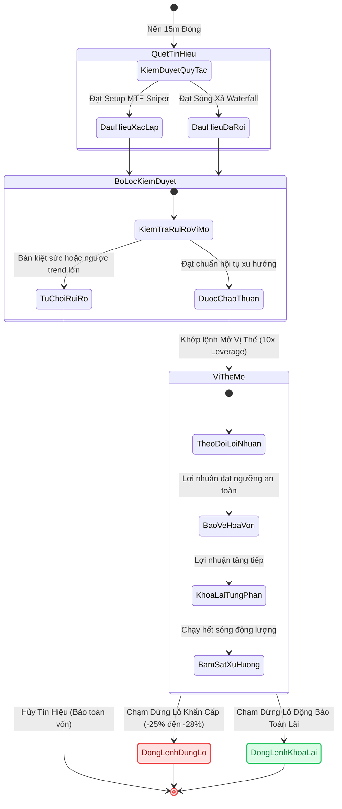

# System Patterns

## Architecture layers
1. **Market Intelligence** — MTF indicators, macro regime (1D), wave filters (4H), location (1H).
2. **Signal Engine** — MTF Sniper rules + MomentumRadar + JEV Hunter → candidate pool.
3. **Risk / Authorization** — cooldown, circuit breaker, directional lock, distress guard, JEV Decision Gate.
4. **Position Management** — `custom_stoploss` ladder, trend runner (EMA21 1H), timeout, ROI table.

## Key design patterns
- **Regime ≠ trigger**: 15m beauty is insufficient without HTF support.
- **Hunter proposes, never self-executes**: must pass strategy filters + confirm gate.
- **Structured Typesafe calls**: `state` + closed `questions` (choice / noul), not free chat.
- **SQLite caches** for Hunter/Gatekeeper verdicts (version + payload hash aware).
- **Fail policy explicit**: strategy `jev_fail_policy` default historically `allow`; Decision engine env default historically `reject` — keep them intentional and documented.

## JEV contracts (post-2026-11-17 fix)
### Hunter setups tradeable
| Side | Valid setup |
|---|---|
| SHORT | `waterfall_collapse` |
| LONG | `breakout_expansion` only |

`absorption_trap` / `trend_pullback` remain labels but are **not** tradeable via `is_setup_valid_for_side` / strategy gate.

### Decision Gate (external)
- Model: `jev-latest` (resolves e.g. `jev-1.14.0`)
- Confirm if `noul >= JEV_CONFIRM_THRESHOLD` (default **0.60**)
- Hard **VETO** if `market_regime == choppy_ranging`
- Native gate still uses heuristic score ≥ **0.70**

### Mode control
- Single switch: `JEV_MODE` ∈ `native | external | backtest`
- Removed legacy `ENABLE_EXTERNAL_JEV`

## Risk patterns present
- Stoploss ladder by ROE
- Streak circuit breaker (strategy-isolated; ignore `strategy=None` unless legacy flag)
- Portfolio directional lock + distress (~−8% ROE on other open trade)
- Leverage `min(10, max_leverage)`

## Risk patterns still weak / missing
- True risk-based position sizing from stop distance (dynamic sizing today is mostly tag multipliers)
- Daily / portfolio loss limits
- Correlation-aware exposure
- Liquidation distance guard + exchange SL verification as first-class ops checks

---

## Trade Lifecycle Statechart & Invariants (Formal Architecture Standards)

### 1. Invariants (Bất biến hệ thống không thể vi phạm)
- **Invariant 1 (Ủy quyền Vào lệnh Tuyệt đối):** Không có lệnh nào được mở nếu không vượt qua cả Bộ lọc Thiết lập (Setup Eligibility) và Bộ lọc Hướng/Chính sách (Directional Policy).
- **Invariant 2 (Bảo vệ Hai Vùng Đà Rơi - Dual-Regime):** Tín hiệu Waterfall phải thuộc Vùng Chân Không (`floor_dist <= 0` không dãn đáy kiệt sức) hoặc Vùng Động Lượng Trong Hộp (`floor_dist > 0` kèm hội tụ biến động mở rộng và không chống sóng lớn).
- **Invariant 3 (Kỷ luật Quản trị Vốn):** Không bao giờ vượt quá 2 vị thế đồng thời (`max_open_trades = 2`); tuân thủ tuyệt đối thời gian hồi nến (cooldown bars) giữa các lệnh cùng chiều.
- **Invariant 4 (Bảo vệ Chiều Giảm Một Chiều):** Dừng lỗ động (Trailing Stoploss) chỉ được dịch chuyển theo hướng bảo toàn vốn hoặc khóa lợi nhuận (ratchet up), tuyệt đối không bao giờ nới lỏng xuống mức rủi ro sâu hơn.

### 2. Sơ đồ Vòng đời Vị thế (User-Centric Statechart)

---

## Important anti-patterns discovered
- Long Hunter prompt historically mean-reversion while strategy philosophy is trend-follow.
- Strategy gate required `breakout_expansion` while Hunter never emitted it → Long Hunter dead path.
- External Gate threshold `0.25` was far looser than native `0.70` and ignored choppy regime.
- Report `+108k` heavily 2026-concentrated; treat as **non-authoritative** until reproduced.
