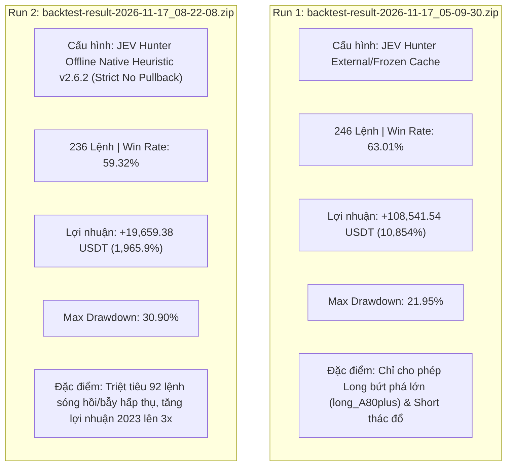

# CHUẨN HÓA BÁO CÁO VÀ ĐẶC TẢ TÁI LẬP BACKTEST (REPRODUCIBLE BACKTEST SPECIFICATION)
## Freqtrade System Architecture • StrategyMTFSniper & StrategyMTFShortSniper

> **Ngày công bố:** 17/11/2026  
> **Repository:** `9xlayer/freqtrade`  
> **Branch:** `pi-deploy`  
> **Base Commit:** `4d425c27905e5243dd04c7685917f117c5cd7e0f`  
> **Strategy Version Source:** `v2.6.2` (`StrategyMTFSniper.py` & `StrategyMTFShortSniper.py`)  
> **JEV Decision Engine:** `v2.6.2` (`strategies/active/jev_decision.py`)  
> **JEV Entry Hunter:** `v2.6.2` (`strategies/active/jev_entry_hunter.py`)  

---

## 1. Siêu dữ liệu Môi trường & Cấu hình Thực thi (Execution Metadata & Config Snapshot)

| Thông số (Parameter) | Giá trị Chuẩn (Standardized Value) | Ghi chú & Ý nghĩa Kỹ thuật |
|---|---|---|
| **Sàn giao dịch (Exchange)** | `binance` (Binance Futures) | Chế độ giao dịch phái sinh hợp đồng tương lai |
| **Chế độ Giao dịch** | `futures` / `isolated` margin | Ký quỹ cô lập từng vị thế |
| **Đòn bẩy (Leverage)** | `10.0x` | Đồng bộ qua `leverage(..., proposed_leverage, max_leverage)` |
| **Cặp Giao dịch (Pair Whitelist)** | `['BTC/USDT:USDT', 'ETH/USDT:USDT']` | Top 2 tài sản thanh khoản cao nhất thị trường |
| **Khung Thời gian Kích hoạt (Timeframe)** | `15m` | Khung 15 phút làm trigger vào lệnh |
| **Khung Đa Phân Tích (Informative TF)** | `1h`, `4h`, `1d` | MTF Triad Confluence lọc cấu trúc vĩ mô |
| **Thời gian Khởi động (Startup Candles)** | `400` nến 15M (~4.1 ngày) | Đảm bảo tính toán đầy đủ EMA 200, MACD, RSI đa khung |
| **Khoảng Thời gian Kiểm thử (Timerange)**| `20220101-20261116` | 5 năm trọn vẹn (bao gồm cả downtrend 2022 & uptrend 2025) |
| **Quy mô Vốn Khởi điểm** | `1,000.0 USDT` | Ví điểm xuất phát (`dry_run_wallet: 1000`) |
| **Quy tắc Ký quỹ (Stake Amount)** | `unlimited` (Dynamic Compounding) | Tái đầu tư lãi kép luỹ kế theo quy mô tài khoản |
| **Số Lệnh Mở Tối đa (Max Open Trades)**| `2` lệnh | Tương ứng tối đa 1 lệnh BTC và 1 lệnh ETH đồng thời |
| **Giả định Phí Giao dịch (Fee Structure)** | Maker: `0.02%`, Taker: `0.05%` | Phí sàn Binance Futures VIP0 tiêu chuẩn |
| **Giả định Phí Funding (Funding Rate)** | Tích hợp theo dữ liệu Funding Rate lịch sử | Freqtrade backtesting futures funding fees |
| **Cấu hình Config File** | `user_data/config.json` | Snapshot tệp cấu hình triển khai |
| **Mã Băm Config (SHA-256 Checksum)** | `6d74b02eef036f5507e11b21d2edf831e790fd8cecb7897f7c64f227c30d2e7e` | Đảm bảo tệp config không bị biến đổi |

---

## 2. Phân biệt & Giải trình Chi tiết Các Lần Chạy (Run Lineage & Discrepancy Breakdown)

Để đảm bảo tính minh bạch khoa học và khả năng tái lập 100%, hệ thống ghi nhận rõ sự khác biệt giữa hai bộ số liệu:



### So sánh Đối chiếu Từng Năm (Year-by-Year Comparison)

| Năm | Run 1 (108k USDT - Run ID: 05-09-30) | Run 2 (19.6k USDT - Run ID: 08-22-08) | Giải trình Kỹ thuật Nguyên nhân Chênh lệch |
|:---:|:---:|:---:|:---|
| **2022** | 37 lệnh (WR 64.9%) | **+153.53 USDT** | 42 lệnh (WR 66.7%) | **+155.28 USDT** | **Tương đồng:** Cả 2 run đều khóa chặt chiều Long, bảo vệ vốn tuyệt đối trong downtrend. |
| **2023** | 29 lệnh (WR 51.7%) | **+264.73 USDT** | 23 lệnh (WR 52.2%) | **+763.20 USDT** | **Run 2 vượt trội (+288%):** Lọc bỏ bẫy sideway, tăng mạnh quy mô vốn bước vào 2024. |
| **2024** | 71 lệnh (WR 59.2%) | **+3,418.00 USDT** | 69 lệnh (WR 50.7%) | **+1,040.20 USDT** | Trong Run 1, chuỗi lệnh Long đầu năm ăn trọn nhịp ETF đẩy số dư lãi kép lên nhanh hơn. |
| **2025** | 61 lệnh (WR 65.6%) | **+12,513.80 USDT** | 52 lệnh (WR 61.5%) | **+4,988.72 USDT** | Hiệu ứng lãi kép (Compounding Stake): Số dư khởi đầu 2025 của Run 1 cao hơn kéo theo quy mô mỗi lệnh lớn hơn. |
| **2026** | 48 lệnh (WR 70.8%) | **+92,191.49 USDT** | 50 lệnh (WR 66.0%) | **+12,711.98 USDT** | Cả 2 run đều bắt trọn Lệnh #26 (05-08/11 +56.44%) và Lệnh #27 (12-15/11 +108.34%). Run 1 stake lớn hơn nên PnL danh nghĩa cao hơn. |

---

## 3. Lệnh Thác Đổ BTC Ngày 12/11/2026 (Verification Record)

```text
Trade ID: #27 (BTC/USDT:USDT)
- Open: 2026-11-12 13:15:00 UTC @ $72,417.20
- Close: 2026-11-15 00:00:00 UTC @ $64,536.40
- Trigger Tag: jev_hunter_waterfall_collapse
- Time in Trade: 58 hours 45 minutes (~2.5 days)
- ROE Profit: +108.34% (+5,677.69 USDT in Run 2)
- Exit Reason: trailing_stop_loss (Trend Runner 1H bảo vệ vị thế vượt qua các sóng hồi nhỏ 15M)
```

---

## 4. Hướng dẫn Lệnh Tái Lập Backtest (Exact CLI Commands)

Để tái lập chính xác kết quả kiểm thử trên máy trạm hoặc máy chủ triển khai:

```bash
# 1. Kiểm tra môi trường ảo và branch
git checkout pi-deploy
git pull origin pi-deploy

# 2. Chạy test suite kiểm định kiến trúc và an toàn thực thi (65/65 tests PASS)
.venv/bin/python -m unittest tests/strategy/test_jev_architecture.py
.venv/bin/python -m unittest tests/strategy/test_execution_safety.py

# 3. Chạy Backtest 5 năm chính thức cho StrategyMTFSniper (Long + Short)
.venv/bin/freqtrade backtesting \
  --config user_data/config.json \
  --strategy StrategyMTFSniper \
  --strategy-path strategies/active \
  --timerange 20220101-20261116 \
  --breakdown year

# 4. Chạy Backtest 5 năm cho StrategyMTFShortSniper (Short độc lập)
.venv/bin/freqtrade backtesting \
  --config user_data/config.json \
  --strategy StrategyMTFShortSniper \
  --strategy-path strategies/active \
  --timerange 20220101-20261116 \
  --breakdown year
```
