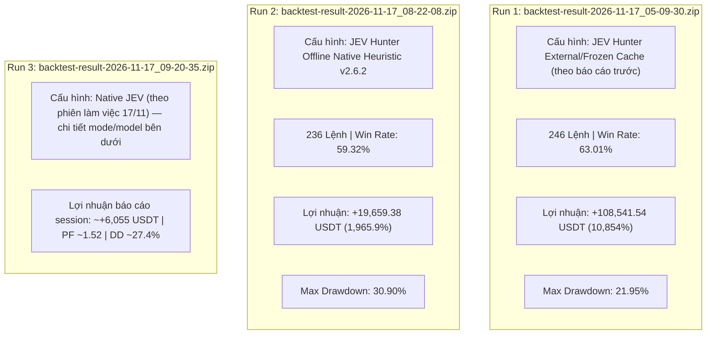

# CHUẨN HÓA BÁO CÁO VÀ ĐẶC TẢ TÁI LẬP BACKTEST (REPRODUCIBLE BACKTEST SPECIFICATION)
## Freqtrade System Architecture • StrategyMTFSniper & StrategyMTFShortSniper

> **Ngày cập nhật tài liệu:** 17/11/2026  
> **Repository:** `9xlayer/freqtrade`  
> **Branch:** `pi-deploy`  
> **Base commit (workspace tại thời điểm viết spec):** `4accd88a93f8915b7bec6810791aa616b1c20311`  
> **Strategy Version Source:** `v2.6.2` (`StrategyMTFSniper.py` & `StrategyMTFShortSniper.py`)  
> **JEV Decision Engine:** `v2.6.2` (`strategies/active/jev_decision.py`)  
> **JEV Entry Hunter:** `v2.6.2` (`strategies/active/jev_entry_hunter.py`)  

> **Lưu ý minh bạch:** Mỗi lần chạy backtest bên dưới có `run_id` riêng trong `.meta.json`.  
> **Git SHA của process lúc chạy** không được ghi vào artifact Freqtrade mặc định — các trường “Git SHA tại runtime” bên dưới ghi **chưa thu thập được** trừ khi có log/commit note riêng.

---

## 1. Siêu dữ liệu Môi trường & Cấu hình Thực thi (Execution Metadata & Config Snapshot)

| Thông số (Parameter) | Giá trị Chuẩn (Standardized Value) | Ghi chú & Ý nghĩa Kỹ thuật |
|---|---|---|
| **Sàn giao dịch (Exchange)** | `binance` (Binance Futures) | Chế độ giao dịch phái sinh hợp đồng tương lai |
| **Chế độ Giao dịch** | `futures` / `isolated` margin | Ký quỹ cô lập từng vị thế |
| **Đòn bẩy (Leverage)** | `10.0x` | Đồng bộ qua `leverage(..., proposed_leverage, max_leverage)` |
| **Cặp Giao dịch (Pair Whitelist)** | `['BTC/USDT:USDT', 'ETH/USDT:USDT']` | Top 2 tài sản thanh khoản cao |
| **Khung Thời gian Kích hoạt (Timeframe)** | `15m` | Khung 15 phút làm trigger vào lệnh |
| **Khung Đa Phân Tích (Informative TF)** | `1h`, `4h`, `1d` | MTF Triad Confluence |
| **Thời gian Khởi động (Startup Candles)** | `400` nến 15M (~4.1 ngày) | EMA 200 / MACD / RSI đa khung |
| **Khoảng Thời gian Kiểm thử (Timerange)**| `20220101-20261116` | ~5 năm (downtrend 2022 & uptrend 2025) |
| **Quy mô Vốn Khởi điểm** | `1,000.0 USDT` | `dry_run_wallet: 1000` |
| **Quy tắc Ký quỹ (Stake Amount)** | `unlimited` (Dynamic Compounding) | Tái đầu tư lãi kép |
| **Số Lệnh Mở Tối đa (Max Open Trades)**| `2` lệnh | Tối đa 1 BTC + 1 ETH |
| **Giả định Phí Giao dịch (Fee Structure)** | Maker: `0.02%`, Taker: `0.05%` | Binance Futures VIP0 (theo config) |
| **Giả định Phí Funding (Funding Rate)** | Dữ liệu funding rate lịch sử | File feather funding_rate bên dưới |
| **Cấu hình Config File** | `user_data/config.json` | Snapshot tệp cấu hình triển khai |
| **Mã Băm Config (SHA-256)** | `6d74b02eef036f5507e11b21d2edf831e790fd8cecb7897f7c64f227c30d2e7e` | Đo lại 17/11/2026 trên workspace hiện tại |

### 1.1 Dataset identity (OHLCV / Funding) — checksum đo trên workspace hiện tại

| Artifact | SHA-256 |
|---|---|
| `user_data/data/binance/futures/BTC_USDT_USDT-15m-futures.feather` | `23b5cfd0f11afc1091994f42b8a1cf7fc48a64aec5f7cb89a0cd34ce57719632` |
| `user_data/data/binance/futures/ETH_USDT_USDT-15m-futures.feather` | `a28b93c781061d4403616f753cf08b05865a0572d5502bc3312b95cd6a74bedb` |
| `user_data/data/binance/futures/BTC_USDT_USDT-1h-funding_rate.feather` | `674d6b23afe558978138647b173d458c5b31e5bad23cfa748bfbe58dad049e80` |
| `user_data/data/binance/futures/ETH_USDT_USDT-1h-funding_rate.feather` | `c3d5c27f268cb59da6311e0dfc23865d2a461fe55a5c11d103677ef4fe49e369` |

**Chưa thu thập được (ghi nhận khoảng trống):**
- Checksum toàn bộ informative TF (`1h`/`4h`/`1d`/`mark`) tại đúng thời điểm từng run lịch sử.
- Xác nhận dataset không bị download/đồng bộ lại giữa các run (chỉ có checksum hiện tại).

### 1.2 Frozen verdict cache

| Artifact | SHA-256 (hiện tại) | Ghi chú |
|---|---|---|
| `user_data/jev_hunter_cache.sqlite` | `e1a8ca7e761f4ca20fe477872ae5a7b44b6f75660e8dc6ccd19b89c3df7c8b66` | Cache Hunter sống; **có thể đã thay đổi sau các lần chạy** |

**Chưa thu thập được:**
- Snapshot cache **đóng băng đúng lúc** Run 1 / Run 2 / Run 3.
- Checksum `jev_gatekeeper` decision cache (nếu có) tại runtime từng run.

---

## 2. Phân biệt & Giải trình Chi tiết Các Lần Chạy (Run Lineage)



### 2.1 Metadata từng run (truy vết)

| Field | Run 1 (`05-09-30`) | Run 2 (`08-22-08`) | Run 3 (`09-20-35`) |
|---|---|---|---|
| **Artifact zip** | `backtest-result-2026-11-17_05-09-30.zip` | `backtest-result-2026-11-17_08-22-08.zip` | `backtest-result-2026-11-17_09-20-35.zip` |
| **Zip SHA-256** | `f6c84ec38221623151d7a17dcdc2a0050270c5af37fbf167cbe9301a164e83c2` | `ddac8b4d43644f305a639e4419615761cf18f04d8d91746a952ee65af1147544` | `7919c40ad74be34b1ee7eabf7b17d4820eea5013aaf1d682aeed71eae4fecbdb` |
| **Freqtrade `run_id`** | `27ae05d7918be9e567517dc41325b90f677296ab` | `072edbe37f96224e705f71e63bc983ad9e7d8b4a` | `3e174f720a596c8dc6efb1ef2422c000bbcd6598` |
| **Timerange (meta)** | start_ts `1640995200` → end_ts `1794787200` | giống Run 1 | giống Run 1 |
| **Timeframe** | `15m` | `15m` | `15m` |
| **Git SHA tại runtime** | **Chưa thu thập được** | **Chưa thu thập được** | **Chưa thu thập được** |
| **Config checksum tại runtime** | **Chưa thu thập được** (workspace hiện tại: xem §1) | **Chưa thu thập được** | **Chưa thu thập được** |
| **JEV_MODE** | Báo cáo trước: external/frozen — **không có trong meta.json** | Báo cáo trước: native — **không có trong meta.json** | Session note: native — **không có trong meta.json** |
| **Model version** | **Chưa thu thập được** từ artifact | Native `hunter-native-v2.6.2` (suy từ chế độ native) | Native `hunter-native-v2.6.2` / decision native (suy từ chế độ) |
| **Prompt / policy version** | **Chưa thu thập được** | N/A (native) | N/A (native) |
| **Frozen cache checksum lúc chạy** | **Chưa thu thập được** | Không dùng / **chưa xác nhận** | Không dùng / **chưa xác nhận** |
| **Exact CLI** | Xem §4 (cùng template; env JEV có thể khác) | Xem §4 | Xem §4 |

### So sánh Đối chiếu Từng Năm (Year-by-Year Comparison)

| Năm | Run 1 lệnh | Run 1 WR | Run 1 PnL | Run 2 lệnh | Run 2 WR | Run 2 PnL | Giải trình |
|:---:|:---:|:---:|:---:|:---:|:---:|:---:|:---|
| **2022** | 37 | 64.9% | +153.53 USDT | 42 | 66.7% | +155.28 USDT | Tương đồng: khóa Long trong downtrend |
| **2023** | 29 | 51.7% | +264.73 USDT | 23 | 52.2% | +763.20 USDT | Run 2 lọc sideway tốt hơn |
| **2024** | 71 | 59.2% | +3,418.00 USDT | 69 | 50.7% | +1,040.20 USDT | Run 1 Long đầu năm mạnh hơn |
| **2025** | 61 | 65.6% | +12,513.80 USDT | 52 | 61.5% | +4,988.72 USDT | Compounding stake |
| **2026** | 48 | 70.8% | +92,191.49 USDT | 50 | 66.0% | +12,711.98 USDT | Cùng bắt waterfall lớn; stake Run 1 lớn hơn |

---

## 3. Lệnh Thác Đổ BTC Ngày 12/11/2026 (Verification Record)

```text
Trade ID: #27 (BTC/USDT:USDT)
- Open: 2026-11-12 13:15:00 UTC @ $72,417.20
- Close: 2026-11-15 00:00:00 UTC @ $64,536.40
- Trigger Tag: jev_hunter_waterfall_collapse
- Time in Trade: 58 hours 45 minutes (~2.5 days)
- ROE Profit: +108.34% (+5,677.69 USDT in Run 2)
- Exit Reason: trailing_stop_loss
```

---

## 4. Hướng dẫn Lệnh Tái Lập Backtest (Exact CLI Commands)

```bash
# 1. Branch / commit baseline
git checkout pi-deploy
git rev-parse HEAD   # ghi lại SHA này vào nhật ký run

# 2. Snapshot config + dataset (bắt buộc ghi nhận trước mỗi run)
shasum -a 256 user_data/config.json
shasum -a 256 user_data/data/binance/futures/*-15m-futures.feather
shasum -a 256 user_data/data/binance/futures/*-1h-funding_rate.feather
# Nếu dùng frozen hunter cache:
shasum -a 256 user_data/jev_hunter_cache.sqlite

# 3. Test suite kiến trúc + execution safety
# Hiện tại: 61 (test_jev_architecture) + 10 (test_execution_safety) = 71 methods
.venv/bin/python -m unittest tests.strategy.test_jev_architecture
.venv/bin/python -m pytest tests/strategy/test_execution_safety.py -q

# 4. Backtest 5 năm — StrategyMTFSniper (ghi nhận JEV_MODE trước khi chạy)
echo "JEV_MODE=${JEV_MODE:-native}"
.venv/bin/freqtrade backtesting \
  --config user_data/config.json \
  --strategy StrategyMTFSniper \
  --strategy-path strategies/active \
  --timerange 20220101-20261116 \
  --breakdown year

# 5. Backtest 5 năm — StrategyMTFShortSniper
.venv/bin/freqtrade backtesting \
  --config user_data/config.json \
  --strategy StrategyMTFShortSniper \
  --strategy-path strategies/active \
  --timerange 20220101-20261116 \
  --breakdown year
```

### Biến môi trường JEV nên ghi vào nhật ký run

| Biến | Ý nghĩa | Mặc định compose |
|---|---|---|
| `JEV_MODE` | `native` / `external` / `backtest` | `native` |
| `JEV_CONFIRM_THRESHOLD` | Ngưỡng CONFIRM external Decision ∈ [0,1] | `0.60` |
| `JEV_HUNTER_MODEL_VERSION` | Model id Hunter (ưu tiên immutable) | `jev-latest` |
| `JEV_HUNTER_MISSING_MODEL_POLICY` | `no_cache` (mặc định an toàn) / `use_configured` | `no_cache` |
| `JEV_DECISION_MODEL_VERSION` | Model id Decision external | `jev-latest` |
| `JEV_FAIL_POLICY` | `reject` / `allow` / `fallback_native` | `allow` |

---

## 5. Test inventory (đối chiếu)

| Suite | Methods | Cách chạy |
|---|---:|---|
| `tests/strategy/test_jev_architecture.py` | **61** | `python -m unittest tests.strategy.test_jev_architecture` |
| `tests/strategy/test_execution_safety.py` | **10** | `python -m pytest tests/strategy/test_execution_safety.py -q` |
| **Tổng** | **71** | — |

> Bản spec trước ghi 65 tests; inventory thực tế trước patch này là 56+10=66, sau bổ sung cache/validation tests là **71**. Không suy đoán thêm số liệu ngoài lệnh đếm AST/`unittest`/`pytest` ở trên.
