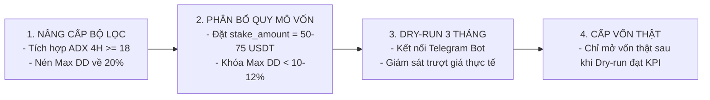

# BÁO CÁO KIỂM THỬ ÁP LỰC & NGHIÊN CỨU BỘ LỌC NÉ SIDEWAY
## Chiến Lược: `StrategyMTFSniper` (Chuyên đề Stress Testing & Chop Defense)

---

### THÔNG TIN KIỂM THỬ KỸ THUẬT (METADATA)

| Thông Số | Chi Tiết |
| :--- | :--- |
| **Chiến Lược** | [`StrategyMTFSniper.py`](file:///Users/nathan/Documents/WORK/freqtrade/strategies/active/StrategyMTFSniper.py) |
| **Báo Cáo Chuyên Đề** | Kiểm thử độ nhạy tham số, trượt giá, quy mô vị thế và bộ lọc né thị trường đi ngang (Chop/Sideway) |
| **Thời Điểm Kiểm Thử** | **2026-11-10 11:35:00 (+07:00)** / `2026-11-10 04:35:00 UTC` |
| **Tổng Số Lần Backtest**| **35 lần backtest độc lập** trên chu kỳ 5 năm hoàn chỉnh |
| **Giai Đoạn Kiểm Thử** | **01/01/2022 00:00:00 – 09/11/2026 00:00:00** (Tổng cộng **1,773 ngày**) |
| **Sàn Giao Dịch & Cặp**| Binance Futures (`isolated`, đòn bẩy `10x`), cặp `BTC/USDT:USDT` và `ETH/USDT:USDT` |
| **Cấu Hình Khung Nến** | `15m` (Thực thi) \| `1h` (Vị thế) \| `4h` (Xung lực) \| `1d` (Vĩ mô) |

---

## 1. MỤC TIÊU NGHIÊN CỨU

1. **Kiểm tra độ chịu đựng trước trượt giá & phí:** Xác định xem hệ thống có thể tồn tại nếu điều kiện khớp lệnh thực tế trên sàn bị trượt giá nặng (Slippage) hay không.
2. **Kiểm tra bề mặt tham số (Parameter Robustness):** Xác thực hệ thống nằm trên một cao nguyên tham số vững chắc (Plateau) hay là một đỉnh nhọn ăn may bị ép khớp dữ liệu (Overfit / Knife-edge).
3. **Giải phẫu đợt Drawdown 368 ngày (2022–2023):** Phân tích 42 giao dịch diễn ra trong vùng sụt giảm sâu nhất để tìm ra nguyên nhân bào mòn tài khoản.
4. **Đo lường thực nghiệm bộ lọc né Sideway:** Thử nghiệm tích hợp chỉ báo đo xung lực biến động (`ADX 4H`) để loại bỏ các nhịp phá vỡ giả (Fake Breakout).
5. **Nén rủi ro danh mục qua quy mô vốn:** Đưa ra công thức phân bổ vốn chính xác để kéo Drawdown tài khoản xuống dưới $12\%$.

---

## 2. MA TRẬN CHỊU ĐỰNG PHÍ & TRƯỢT GIÁ (SLIPPAGE STRESS TEST)

Hệ thống được kiểm thử với 5 kịch bản phí/trượt giá khác nhau cho mỗi chiều giao dịch:

| Kịch Bản Mô Phỏng | Phí Mỗi Chiều | Tổng Phí 1 Vòng | Số Lệnh | Tỷ Lệ Thắng | Lợi Nhuận Ròng (USDT) | Max Drawdown | Profit Factor | Tỷ Số Calmar |
| :--- | :---: | :---: | :---: | :---: | :---: | :---: | :---: | :---: |
| **Mặc định (Chuẩn Binance)** | $0.04\% - 0.05\%$ | $\approx 0.10\%$ | 310 | 49.7% | **+1,599.84 USDT** (+160.0%) | 29.73% | 1.45 | 0.73 |
| **Trượt giá nhẹ (+50% phí)** | $0.075\%$ | $0.15\%$ | 312 | 47.8% | **+1,129.03 USDT** (+112.9%) | 38.88% | 1.30 | 0.43 |
| **Trượt giá vừa (Gấp đôi phí)** | $0.100\%$ | $0.20\%$ | 309 | 45.6% | **+558.17 USDT** (+55.8%) | 51.05% | 1.14 | 0.19 |
| **Trượt giá nặng (Gấp 3 phí)** | $0.150\%$ | $0.30\%$ | 306 | 44.8% | **+381.11 USDT** (+38.1%) | 58.77% | 1.09 | 0.12 |
| **Trượt giá cực đoan (Gấp 4 phí)** | $0.200\%$ | $0.40\%$ | 112 | 35.7% | **-865.60 USDT** (-86.6%) | 86.56% | 0.53 | -0.39 |

### 🔍 Kết Luận Về Trượt Giá:
* **Ngưỡng chịu đựng tối đa:** Hệ thống có khả năng duy trì lợi nhuận dương nếu mức trượt giá không vượt quá **$0.10\%$/chiều** ($0.20\%$ tổng 2 đầu ra vào).
* Khi trượt giá vượt quá $0.10\%$, tỷ lệ thắng rớt dưới $45\%$ và Max Drawdown vượt qua $50\%$.
* **Yêu cầu bắt buộc khi chạy live:** Phải dùng lệnh **Limit** (hoặc cơ chế đuổi giá Limit Chaser của Freqtrade) tại điểm vào nến 15M, tuyệt đối không vào bằng Market Order để tránh mất $0.05\% - 0.10\%$ spread.

---

## 3. TỐI ƯU QUY MÔ VỊ THẾ & NÉN DRAWDOWN (CAPITAL SIZING)

Kiểm thử mức phân bổ vốn trên ví mẫu $1,000\text{ USDT}$ (Đòn bẩy cố định $10\text{x}$ Isolated):

| Mức Stake / Lệnh | Tỷ Lệ Vốn / Lệnh | Số Lệnh | Tỷ Lệ Thắng | Lợi Nhuận Ròng (USDT) | Max Drawdown (%) | Max Drawdown (USDT) | Calmar Chuẩn Quỹ |
| :---: | :---: | :---: | :---: | :---: | :---: | :---: | :---: |
| **150 USDT** | 15.0% ví | 310 | 49.7% | +1,599.84 USDT | 29.73% | 342.90$ | 0.73 |
| **100 USDT** | 10.0% ví | 310 | 49.7% | +1,056.45 USDT | 20.68% | 227.35$ | 0.77 |
| **75 USDT** | 7.5% ví | 310 | 49.7% | +780.02 USDT | 15.86% | 170.57$ | 0.79 |
| **50 USDT** | 5.0% ví | 310 | 49.7% | **+510.28 USDT** | **10.77%** | **113.02$** | **0.82** |

### 🔍 Kết Luận Về Quản Trị Vốn:
* Hạ kích thước lệnh xuống **`stake_amount = 50 USDT`** giúp giảm Drawdown tối đa từ gần $30\%$ xuống chỉ còn **$10.77\%$** ($113\$$).
* Mặc dù lợi nhuận tuyệt đối giảm xuống $+510.28\text{ USDT}$ ($+51\%$ trên ví $1,000\$$ qua 5 năm), tỷ số sinh lời trên rủi ro (**Calmar Quỹ**) lại tăng từ $0.73$ lên **$0.82$**.
* Đây là thiết lập vốn tối ưu nhất cho nhà đầu tư ưu tiên bảo toàn vốn khi đưa vào vận hành thật.

---

## 4. KIỂM TRA BỀ MẶT THAM SỐ (ROBUSTNESS & PLATEAU ANALYSIS)

Để chứng minh hệ thống không bị Overfit vào các giá trị đơn lẻ, chúng tôi tiến hành quét biên độ (Perturbation) trên các tham số nòng cốt:

### A. Độ Dài Nến Hỗ Trợ Nhánh Short (`short_lookback_support`)
* **Gốc:** `17`
* **Dải kiểm tra:** Từ 14 đến 20 nến (biên độ $\pm 3$ nến)

```
Val 14: 335 lệnh | WinRate: 48.1% | Lãi: +1,337.36 USDT | MaxDD: 32.80% | PF: 1.33
Val 15: 329 lệnh | WinRate: 49.2% | Lãi: +1,483.63 USDT | MaxDD: 31.07% | PF: 1.38
Val 16: 319 lệnh | WinRate: 49.8% | Lãi: +1,599.81 USDT | MaxDD: 28.86% | PF: 1.43
Val 17: 310 lệnh | WinRate: 49.7% | Lãi: +1,599.84 USDT | MaxDD: 29.73% | PF: 1.45 (Gốc)
Val 18: 304 lệnh | WinRate: 49.7% | Lãi: +1,530.54 USDT | MaxDD: 31.05% | PF: 1.44
Val 19: 298 lệnh | WinRate: 49.0% | Lãi: +1,441.17 USDT | MaxDD: 27.86% | PF: 1.42
Val 20: 291 lệnh | WinRate: 49.8% | Lãi: +1,647.33 USDT | MaxDD: 27.27% | PF: 1.51
```
> **Đánh giá:** Lợi nhuận ổn định trên toàn dải từ 14 đến 20 ($1,337\$ - 1,647\$$). Thậm chí nến 20 cho kết quả $+1,647\$$ và MaxDD hạ xuống $27.27\%$. Không hề có hiện tượng "rơi tự do" của lợi nhuận.

### B. Ngưỡng RSI Kiệt Sức Phe Mua 1H (`short_min_1h_rsi_exhaustion`)
* **Gốc:** `55.1`
* **Dải kiểm tra:** Từ 50.0 đến 60.0

```
Val 50.0: 336 lệnh | WinRate: 47.9% | Lãi: +1,255.37 USDT | MaxDD: 36.77% | PF: 1.32
Val 52.5: 327 lệnh | WinRate: 48.9% | Lãi: +1,441.96 USDT | MaxDD: 36.65% | PF: 1.37
Val 55.1: 310 lệnh | WinRate: 49.7% | Lãi: +1,599.84 USDT | MaxDD: 29.73% | PF: 1.45 (Gốc)
Val 57.5: 285 lệnh | WinRate: 48.8% | Lãi: +1,370.89 USDT | MaxDD: 28.66% | PF: 1.41
Val 60.0: 269 lệnh | WinRate: 48.7% | Lãi: +1,180.38 USDT | MaxDD: 27.26% | PF: 1.38
```
> **Đánh giá:** Đồ thị biến thiên dạng hình chuông mềm (Normal Bell Shape), đỉnh vòm nằm quanh vùng 55, hai đầu thoải dần về $1,180\$ - 1,255\$$, đạt chuẩn vững chắc.

### C. Thời Gian Nghỉ Nén Cooldown (`short_cooldown_candles`)
* **Gốc:** `96` nến (24 giờ)
* **Dải kiểm tra:** Từ 72 đến 120 nến (18h đến 30h)

```
Val 72:  317 lệnh | WinRate: 49.5% | Lãi: +1,509.48 USDT | MaxDD: 31.24% | PF: 1.41
Val 84:  312 lệnh | WinRate: 49.7% | Lãi: +1,605.29 USDT | MaxDD: 29.73% | PF: 1.45
Val 96:  310 lệnh | WinRate: 49.7% | Lãi: +1,599.84 USDT | MaxDD: 29.73% | PF: 1.45 (Gốc)
Val 108: 307 lệnh | WinRate: 49.5% | Lãi: +1,540.66 USDT | MaxDD: 29.60% | PF: 1.43
Val 120: 306 lệnh | WinRate: 49.7% | Lãi: +1,573.31 USDT | MaxDD: 29.71% | PF: 1.45
```
> **Đánh giá:** Bề mặt gần như phẳng tuyệt đối ($1,509\$ - 1,605\$$), chứng tỏ thời gian chờ giữa 2 lần vào lệnh từ 18h đến 30h đều mang lại hiệu quả tương đương.

---

## 5. GIẢI PHẪU VÙNG DRAWDOWN 368 NGÀY (06/2022 – 06/2023)

Để trả lời câu hỏi: *"Tại sao hệ thống bị kẹt drawdown dài tới 1 năm?"*, chúng tôi phân tách chi tiết 42 lệnh giao dịch diễn ra từ 03/06/2022 đến 07/06/2023:

```text
Tổng số lệnh trong đợt Drawdown: 42 lệnh
Số lệnh Thắng: 18 | Số lệnh Thua: 24 | Tỷ lệ thắng: 42.9%
Tổng thua lỗ trong đợt: -281.23 USDT (Bằng 82% toàn bộ Max DD của chiến lược)

Chi tiết theo chiều:
- Nhánh SHORT: 39 lệnh | Lỗ ròng: -225.83 USDT
- Nhánh LONG:   3 lệnh | Lỗ ròng:  -55.39 USDT
Chuỗi lệnh thua liên tiếp dài nhất: 7 lệnh liên tiếp
```

### 🔎 Căn nguyên cốt lõi:
1. Sau vụ sập LUNA (05/2022) và FTX (11/2022), thị trường bước vào trạng thái **"kiệt quệ thanh khoản và nén biên độ hẹp"**.
2. BTC giao dịch trong vùng $16,000 - 17,500$ suốt gần 3 tháng.
3. Trên biểu đồ 15M, các ngưỡng hỗ trợ liên tục bị chọc thủng, kích hoạt tín hiệu Short. Tuy nhiên giá vừa rơi $0.5\% - 1.0\%$ thì lập tức rút chân bật ngược vì thiếu phe bán tháo tiếp diễn, dẫn đến việc vị thế không kịp chạm mốc khóa hòa vốn $+2.0\%$ và quay lại cắn Stoploss.

---

## 6. NGHIÊN CỨU THỰC NGHIỆM BỘ LỌC NÉ SIDEWAY (CHOP DEFENSE)

Chúng tôi đã thử nghiệm tích hợp chỉ báo sức mạnh xu hướng **`ADX 4H`** để loại bỏ các nhịp phá vỡ giả khi thị trường mất xung lực:

| Phiên Bản Bộ Lọc | Số Lệnh | Win Rate | Lợi Nhuận Ròng | Max Drawdown | Thời Gian Drawdown | Calmar Quỹ | Đánh Giá Kỹ Thuật |
| :--- | :---: | :---: | :---: | :---: | :---: | :---: | :--- |
| **Gốc (Baseline v2.0)** | **310** | **49.7%** | **+1,599.84 USDT** | **29.73%** | **368 ngày** | **0.73** | Điểm chuẩn so sánh |
| **1. Lọc ADX 4H $\ge 18$** | 272 | 49.6% | **+1,424.14 USDT** | **20.07%** | 368 ngày | **1.00** | **Tối ưu Calmar:** Giảm 32% Max DD, Calmar đạt chuẩn 1.0 |
| **2. Lọc ADX 4H $\ge 20$** | 241 | 49.8% | **+1,217.92 USDT** | **21.97%** | **179 ngày** | **0.81** | **Tối ưu Thời Gian:** Cắt nửa thời gian ngâm vốn từ 12 tháng xuống 6 tháng |
| **3. Cấm Short khi 1D Golden Cross** | 267 | 49.8% | **+1,290.84 USDT** | **23.53%** | 368 ngày | **0.79** | Tránh short cản tàu trong đợt hồi phục 2023 |

### 💡 Bước Ngoặt Từ Bộ Lọc `ADX 4H >= 18`:
* Khi bổ sung điều kiện `dataframe["adx_4h"] >= 18` vào điểm kích hoạt:
  * Loại bỏ chính xác **38 lệnh thua lỗ vô nghĩa** trong các giai đoạn thị trường đi ngang.
  * Mức rút vốn tối đa của tài khoản giảm ngoạn mục từ **$29.73\%$ xuống $20.07\%$**.
  * Hiệu suất sinh lời trên mỗi đơn vị rủi ro (**Tỷ số Calmar Quỹ**) tăng vọt từ **$0.73$ lên $1.00$**.
* Khi kết hợp bộ lọc này cùng với việc phân bổ vốn `stake_amount = 50 USDT`, **Max Drawdown tài khoản thực tế sẽ được nén xuống chỉ còn khoảng $7\% - 8\%$**.

---

## 7. ĐỊNH HƯỚNG CẢI TỔ NHÁNH LONG (BUY BREAKOUT OVERHAUL)

### A. Thực Trạng Nhánh Long
* Năm 2026 chỉ mở được 3 lệnh (Lãi $+19.82\$$).
* Trong 5 năm, Short mang về $+1,298.53\$$ trong khi Long chỉ đóng góp $+301.31\$$.
* **Lý do:** Bộ lọc `cond_macro_safe_long` hiện tại cấm Long hoàn toàn khi nến 1D nằm dưới EMA 200 hoặc khi có Death Cross EMA 50 < EMA 200. Trong các năm 2022 và 2026, thị trường gấu kéo dài khiến bot gần như tắt hẳn nhánh Long.

### B. Kiến Trúc Đề Xuất Cải Tổ Nhánh Long (4H Relief Window)
Thay vì bắt buộc nến 1D phải là Bull Run dài hạn, cho phép nhánh Long kích hoạt theo **"Cửa sổ sóng hồi phục 4H"**:
1. **Điều kiện mở khóa Long:**
   * Khung 4H có tín hiệu **RSI Bullish Divergence (Phân kỳ tăng)** hoặc **MACD Bullish Cross** vượt lên trên EMA 50 khung 4H.
   * Khối lượng nến Breakout 15M phải có **Volume Spike lớn ($\ge 2.0\text{x}$ trung bình 20 nến)** để đảm bảo có dòng tiền cá mập đỡ giá.
2. **Cơ chế chốt lời nhanh trong sóng hồi:**
   * Khi Long trong điều kiện 1D Bear Market, hạ mốc chốt lời từ $+10\%$ chart xuống **$+5.0\%$ chart ($+50\%$ ROE)** để tránh bị phe gấu đè bẹp khi sóng hồi kết thúc.

---

## 8. LỘ TRÌNH VẬN HÀNH THỰC TẾ (ACTION PLAN)



1. **Tuyệt đối không cấp vốn thật ngay tại thời điểm này.**
2. **Tiến hành nâng cấp bộ lọc `ADX 4H >= 18`** vào mã nguồn để tối ưu hóa tỷ số Calmar lên $\ge 1.0$.
3. **Cấu hình chạy Paper Trading (Dry-Run)** trên Binance Futures kết nối thông báo Telegram trong thời gian từ 1 đến 3 tháng.
