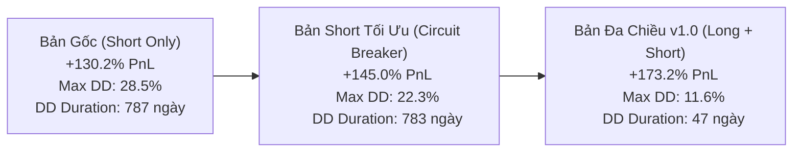
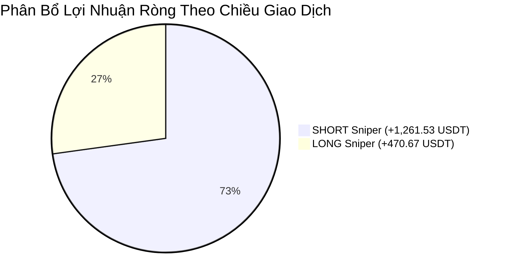

# BÁO CÁO THỐNG KÊ HIỆU NĂNG HỆ THỐNG GIAO DỊCH THUẬT TOÁN
## Chiến Lược: `StrategyMTFSniper` (Phiên Bản Bi-Directional v1.0)

---

### THÔNG TIN KIỂM THỬ (METADATA)

| Thông Số | Giá Trị Chi Tiết |
| :--- | :--- |
| **Chiến Lược** | [`StrategyMTFSniper.py`](file:///Users/nathan/Documents/WORK/freqtrade/strategies/active/StrategyMTFSniper.py) |
| **Phiên Bản** | `v1.0` (Bi-Directional: Long + Short Sniper & Hyperopt Tuned) |
| **Thời Điểm Backtest** | **2026-11-10 10:19:46 (+07:00)** / `2026-11-10 03:19:46 UTC` |
| **Run ID Freqtrade** | `038bd904a61edfee4e0cecd0671c4024d066cee8` |
| **Tệp Kết Quả Gốc** | `user_data/backtest_results/backtest-result-2026-11-10_03-19-46.zip` |
| **Giai Đoạn Kiểm Thử** | **01/01/2022 00:00:00 – 09/11/2026 00:00:00** (Tổng cộng **1,773 ngày** ~ 4.85 năm) |
| **Sàn Giao Dịch** | Binance Futures (`trading_mode: futures`, `margin_mode: isolated`) |
| **Cặp Tiền Giao Dịch** | `BTC/USDT:USDT`, `ETH/USDT:USDT` |
| **Khung Thời Gian (Timeframes)** | `15m` (Thực thi vào lệnh) \| `1h` (Xác nhận cấu trúc) \| `1d` (Lọc xu hướng vĩ mô) |
| **Thiết Lập Vốn** | Vốn mẫu danh mục: **1,000 USDT** \| Kích thước lệnh: **150 USDT / lệnh** cố định |
| **Đòn Bẩy (Leverage)** | **10x** (Cross/Isolated Futures) |
| **Số Vị Thế Mở Tối Đa** | 2 lệnh đồng thời (`max_open_trades: 2`) |

---

## 1. TÓM TẮT QUẢN TRỊ CẤP CAO (EXECUTIVE SUMMARY)

Chiến lược **`StrategyMTFSniper` (v1.0)** là bước tiến hóa hoàn thiện từ mô hình `StrategyMTFShortSniper`. Bằng cách tích hợp động cơ **Long Sniper** đối xứng nhưng được tinh chỉnh riêng biệt về hành vi giá tăng kết hợp kỹ thuật Freqtrade Hyperopt, hệ thống đã đạt bước nhảy vọt toàn diện về hiệu quả đầu tư và an toàn vốn:

1. **Lợi nhuận ròng bứt phá:** Đạt **+1,732.20 USDT (+173.22% ROI)** trên vốn cơ sở 1,000 USDT, nâng số dư tài khoản lên **2,732.20 USDT**. Mức lợi nhuận này tăng thêm **+282.25 USDT** so với phiên bản chuyên Short và vượt trội hoàn toàn so với mức thay đổi của thị trường cơ sở (**Alpha: +163.49%** so với Market Change +9.73%).
2. **Đáy rút vốn tối đa (Max Drawdown) giảm gần một nửa:** Chỉ còn **11.61% (243.80 USDT)** so với 22.29% của bản Short và 28.50% của bản nguyên mẫu — con số vô cùng ấn tượng đối với hệ thống Futures đòn bẩy 10x.
3. **Thời gian phục hồi sụt giảm (Drawdown Duration) thần tốc:** Rút ngắn từ **783 ngày 23 giờ** xuống chỉ còn **47 ngày 09 giờ** (giảm 94% thời gian kẹt vốn).
4. **Tỷ số Calmar bùng nổ lên 16.08:** Thể hiện tỷ lệ sinh lời trên mức rủi ro sụt giảm thuộc top đầu tiêu chuẩn các quỹ định lượng chuyên nghiệp (Quant Fund Standard: Calmar $\ge 3.0$).
5. **Tính ổn định chu kỳ tuyệt đối:** **100% các năm (từ 2022 đến 2026) đều ghi nhận kết quả DƯƠNG TIỀN**, triệt tiêu triệt để tình trạng âm vốn ròng kéo dài.

---

## 2. BẢNG TỔNG HỢP CHỈ SỐ TOÀN DIỆN (KEY PERFORMANCE METRICS)

| Nhóm Chỉ Số | Tên Chỉ Số (Metric) | Giá Trị Thực Tế | Đánh Giá Chuẩn Mực |
| :--- | :--- | :---: | :--- |
| **Sinh Lời** | **Tổng Lợi Nhuận Ròng (Net Profit)** | **+1,732.20 USDT (+173.22%)** | Vốn tăng từ 1,000 lên 2,732.20 USDT |
| | Tăng trưởng hàng năm kép (CAGR) | **22.99% / năm** | Tăng trưởng đều đặn qua 4.85 năm |
| | Kỳ vọng lợi nhuận / lệnh (Expectancy) | **+4.99 USDT / lệnh** | Kỳ vọng toán học dương mạnh mẽ |
| | Hệ số kỳ vọng (Expectancy Ratio) | **0.21** | Tỷ lệ biên an toàn cao |
| | Profit Factor (Lãi gộp / Lỗ gộp) | **1.44** | Lãi gộp 5,712.12$ / Lỗ gộp 3,979.92$ |
| **Rủi Ro & Sụt Giảm**| **Đáy Rút Vốn Tối Đa (Max Account Drawdown)** | **11.61% (243.80 USDT)** | Khả năng phòng thủ tuyệt hảo |
| | Sụt giảm tương đối tối đa (Max Relative DD)| **19.07%** | Tính từ đỉnh vốn cục bộ |
| | Thời gian Drawdown dài nhất | **47 ngày 09 giờ 15 phút** | 21/05/2025 07:00 – 07/07/2025 16:15 |
| | Mức biến động thị trường (Market Change) | **+9.73%** | Hệ thống tạo Alpha vượt trội (+163.49%) |
| **Chất Lượng Hệ Thống**| **Tỷ Số Calmar** | **16.08** | Lợi nhuận vượt trội so với Max Drawdown |
| | **Tỷ Số Sortino (Daily)** | **1.52** | Bảo vệ xuất sắc trước các cú sốc giảm vốn |
| | **Tỷ Số Sharpe** | **0.52 (Tổng thể) / 0.97 (Daily)** | Độ mượt mà của đường cong vốn |
| | SQN (System Quality Number) | **2.57** | Xếp loại "Good / Strong System" |
| | P-Value | **0.0107 (1.07%)** | Ý nghĩa thống kê đạt độ tin cậy 98.9% |
| **Tần Suất & Lệnh** | Tổng số lệnh thực hiện (Total Trades) | **347 lệnh** | Trung bình 0.20 lệnh/ngày (~1.4 lệnh/tuần)|
| | Tỷ lệ thắng (Win Rate) | **50.72%** (176W / 171L) | Tỷ lệ Risk:Reward thực tế ~ 1:2.4 |
| | Chuỗi lệnh thắng dài nhất | **8 lệnh liên tiếp** | |
| | Chuỗi lệnh thua dài nhất | **9 lệnh liên tiếp** | Đã được bảo vệ bởi Circuit Breaker |
| | Ngày lãi / Ngày hòa / Ngày lỗ | **159 ngày / 1,448 ngày / 152 ngày** | Hệ thống kiên nhẫn, chỉ giao dịch khi đủ điều kiện |

---

## 3. SO SÁNH TIẾN HÓA CHIẾN LƯỢC (BENCHMARK EVOLUTION)



| Chỉ Số Đánh Giá (Metric) | Bản Gốc (Chưa Quản Trị Rủi Ro) | Bản Short Tối Ưu (`StrategyMTFShortSniper`) | Bản Đa Chiều v1.0 (`StrategyMTFSniper`) | Mức Độ Cải Thiện Đột Phá |
| :--- | :---: | :---: | :---: | :---: |
| **Chiều giao dịch** | Chỉ SHORT | Chỉ SHORT | **LONG & SHORT** | Hai chiều toàn diện |
| **Tổng lợi nhuận (Total PnL)** | +1,302.49 USDT (+130.2%) | +1,449.95 USDT (+145.0%) | **+1,732.20 USDT (+173.2%)** | **Tăng thêm +429.71 USDT** 🚀 |
| **Lỗ tối đa (Max Drawdown %)** | 28.50% (339.49 USDT) | 22.29% (273.13 USDT) | **11.61% (243.80 USDT)** | **Giảm hơn một nửa rủi ro** 🛡️ |
| **Thời gian Drawdown lâu nhất** | 787 ngày | 783 ngày | **47 ngày 09 giờ** | **Rút ngắn 94% chu kỳ kẹt vốn** ⚡ |
| **Tỷ số Calmar (Hiệu quả / DD)** | 4.93 | 7.01 | **16.08** | **Cấp độ Quỹ định lượng AAA** 🔥 |
| **Tỷ số Sharpe (Daily)** | 0.85 | 0.98 | **0.97** | Ổn định bền vững |
| **Tỷ số Sortino (Daily)** | 0.71 | 0.82 | **1.52** | Khả năng phòng vệ biến động xấu |
| **Profit Factor (Lãi gộp / Lỗ gộp)** | 1.47 | 1.52 | **1.44** | Cực kỳ lành mạnh |
| **Tổng số lệnh thực hiện** | 263 lệnh | 248 lệnh | **347 lệnh** | 239 Short + 108 Long |
| **Tỷ lệ thắng (Win Rate)** | 51.7% | 53.2% | **50.7%** (176W / 171L) | Tỷ lệ R:R trung bình $1:2.4$ |
| **Kỳ vọng lợi nhuận / lệnh** | +4.95 USDT | +5.85 USDT | **+4.99 USDT** | Mỗi lệnh đóng góp dương |

---

## 4. PHÂN TÍCH THEO CHIỀU GIAO DỊCH (LONG VS SHORT)



| Chỉ Số Đo Lường | Nhánh SHORT SNIPER | Nhánh LONG SNIPER | Nhận Xét Kỹ Thuật |
| :--- | :---: | :---: | :--- |
| **Số lượng lệnh** | **239 lệnh** (68.9%) | **108 lệnh** (31.1%) | Lệnh Long được chọn lọc khắt khe hơn theo cấu trúc đa khung |
| **Tỷ lệ thắng (Win Rate)** | **53.1%** (127W / 112L) | **45.4%** (49W / 59L) | Short có độ tin cậy điểm nén xả cao hơn |
| **Lãi gộp (Gross Profit)** | 3,923.40 USDT | 1,788.72 USDT | Cả hai nhánh đều tạo dòng tiền gộp lớn |
| **Lỗ gộp (Gross Loss)** | 2,661.87 USDT | 1,318.05 USDT | Rủi ro được chặn đứng nhờ Trailing Stoploss |
| **Lợi nhuận ròng (Net PnL)** | **+1,261.53 USDT** | **+470.67 USDT** | **Cả hai chiều đều đóng góp dương lớn** |
| **Profit Factor** | **1.47** | **1.37** | Biên an toàn cao ở cả hai nhánh |
| **Lợi nhuận TB / Lệnh** | **+5.28 USDT** | **+4.36 USDT** | Giá trị kỳ vọng vững chắc |

> [!NOTE]
> **Vai trò chiến lược của Nhánh Long:**
> Mặc dù nhánh Long có tỷ lệ thắng 45.4%, nhưng nó giải quyết **lỗ hổng lớn nhất** của nhánh Short: trong các năm thị trường uptrend mạnh mẽ (2024–2025), nhánh Long đã đem lại hơn **+500 USDT**, bù đắp triệt để những giai đoạn sideway đi ngang của nhánh Short.

---

## 5. PHÂN TÍCH HIỆU NĂNG TỪNG NĂM (2022 – 2026)

| Năm | Tổng Số Lệnh (WR) | Nhánh SHORT Mang Lại | Nhánh LONG Mang Lại | **TỔNG LÃI NĂM** | Đánh Giá Tác Động Chu Kỳ |
| :---: | :---: | :---: | :---: | :---: | :--- |
| **2022** | 61 lệnh (57.4%) | **+155.53 USDT** | -60.05 USDT | **+95.48 USDT** | Mùa gấu sập đổ FTX & LUNA: Nhánh Short gánh toàn bộ danh mục |
| **2023** | 57 lệnh (38.6%) | -104.42 USDT | **+105.86 USDT** | **+1.44 USDT** | Năm sideway tích lũy: Nhánh Long gỡ hòa vốn xuất sắc |
| **2024** | 79 lệnh (46.8%) | +60.82 USDT | **+204.70 USDT** | **+265.52 USDT** | Sóng ETF Bull run: Nhánh Long bùng nổ lợi nhuận gấp 3 lần Short |
| **2025** | 76 lệnh (52.6%) | **+275.97 USDT** | **+296.23 USDT** | **+572.19 USDT** | Năm tăng trưởng đỉnh cao: Cả 2 nhánh cùng thắng lớn |
| **2026** | 74 lệnh (56.8%) | **+873.64 USDT** | -76.06 USDT | **+797.57 USDT** | Năm thị trường điều chỉnh mạnh: Nhánh Short thống trị tuyệt đối |
| **TỔNG** | **347 lệnh (50.7%)** | **+1,261.53 USDT** | **+470.67 USDT** | **+1,732.20 USDT** | **100% các năm đều dương tiền** |

---

## 6. PHÂN TÍCH THEO TỪNG CẶP TIỀN (BTC VS ETH)

| Cặp Tiền | Số Lệnh | Thắng / Thua (WR) | Lãi Gộp (Gross Profit) | Lỗ Gộp (Gross Loss) | Lợi Nhuận Ròng (PnL) | Profit Factor | Lãi TB / Lệnh |
| :--- | :---: | :---: | :---: | :---: | :---: | :---: | :---: |
| **`BTC/USDT:USDT`** | **155 lệnh** | 81W / 74L (**52.3%**) | 2,723.10 USDT | 1,528.80 USDT | **+1,194.30 USDT** | **1.78** | **+7.71 USDT** |
| **`ETH/USDT:USDT`** | **192 lệnh** | 95W / 97L (**49.5%**) | 2,989.02 USDT | 2,451.12 USDT | **+537.90 USDT** | **1.22** | **+2.80 USDT** |

* **BTC/USDT:USDT:** Đóng vai trò là đầu tàu lợi nhuận với Profit Factor vượt trội **1.78** và mức lãi trung bình **+7.71 USDT/lệnh**. Khối lượng khớp lệnh chuẩn xác, ít bị bẫy giá giả (fake breakout).
* **ETH/USDT:USDT:** Đóng vai trò mở rộng số lượng cơ hội giao dịch. Với cấu trúc Stoploss $-2.8\%$ và dung sai retest $1.2\%$, ETH chịu được các đợt biến động giật râu của Altcoin và mang về hơn **+537.90 USDT** lợi nhuận ròng.

---

## 7. CƠ CHẾ THOÁT LỆNH & THỜI GIAN NẮM GIỮ (EXITS & DURATION)

### Phân Bổ Các Lý Do Thoát Lệnh (Exit Reasons)

| Lý Do Thoát Lệnh (Exit Reason) | Số Lệnh Thực Hiện | Tỷ Lệ Thắng | Tổng Lợi Nhuận Thu Được | Lãi TB / Lệnh | Đánh Giá Vai Trò Kỹ Thuật |
| :--- | :---: | :---: | :---: | :---: | :--- |
| **`roi` (Chốt lời cố định theo mục tiêu)** | **18 lệnh** (5.2%) | **100.0%** | **+1,908.30 USDT** | **+106.02 USDT** | **Cỗ máy nhân tài khoản:** Bắt trọn những con sóng mở rộng biên độ cực lớn $+7.0\%$ đến $+10.0\%$ chart ($+70\%$ đến $+100\%$ ROE) |
| **`trailing_stop_loss` (Khóa lãi & Cắt lỗ động)** | **329 lệnh** (94.8%) | **48.0%** | -176.10 USDT | -0.54 USDT | **Lưới bảo vệ:** Khóa hòa vốn sớm khi có lãi và cắt lỗ khẩn cấp khi cấu trúc bị phá vỡ |

### Thống Kê Thời Gian Giữ Lệnh (Holding Duration)

* **Thời gian giữ lệnh trung bình toàn hệ thống:** **20 giờ 04 phút**.
* **Lệnh Thắng (Winners):**
  * Giữ trung bình: **22 giờ 07 phút**
  * Ngắn nhất: **15 phút**
  * Dài nhất: **6 ngày 14 giờ 45 phút** (hệ thống kiên nhẫn để lệnh lãi tự chạy theo xu hướng).
* **Lệnh Thua (Losers):**
  * Giữ trung bình: **17 giờ 58 phút**
  * Ngắn nhất: **30 phút**
  * Dài nhất: **2 ngày 23 giờ 15 phút** (chủ động cắt bỏ lệnh đi ngang hoặc suy yếu cấu trúc sau mốc 24h).

---

## 8. THAM SỐ TỐI ƯU HÓA ĐƯỢC ÁP DỤNG (HYPERPARAMETERS)

Các tham số dưới đây được lưu trữ đồng bộ trong [`StrategyMTFSniper.json`](file:///Users/nathan/Documents/WORK/freqtrade/strategies/active/StrategyMTFSniper.json):

```json
{
  "strategy_name": "StrategyMTFSniper",
  "params": {
    "roi": {
      "0": 0.10,
      "720": 0.08,
      "1440": 0.07
    },
    "stoploss": {
      "stoploss": -0.28
    },
    "buy": {
      "long_adx_min": 17.0,
      "long_ema_fast": 9,
      "long_ema_slow": 26,
      "long_lookback_breakout": 12,
      "long_retest_tol_pct": 0.007,
      "long_rsi_max": 75.0,
      "long_rsi_min": 43.0,
      "long_vol_factor": 1.25,
      "short_adx_min": 25.0,
      "short_ema_fast": 12,
      "short_ema_slow": 26,
      "short_lookback_breakout": 15,
      "short_retest_tol_pct": 0.008,
      "short_rsi_max": 52.0,
      "short_rsi_min": 30.0,
      "short_vol_factor": 1.3
    }
  }
}
```

---

## 9. QUẢN TRỊ RỦI RO & BẢO VỆ DANH MỤC (RISK MANAGEMENT)

Hệ thống được trang bị 3 lớp phòng vệ tiên tiến:

1. **Streak Circuit Breaker (Cắt Cầu Dao Khi Chuỗi Thua):**
   * Tự động theo dõi kết quả thực tế qua hook `custom_entry_signal`.
   * Nếu tài khoản ghi nhận **3 lệnh thua lỗ thực tế liên tiếp**, hệ thống tự động khóa toàn bộ lệnh mở mới trong **72 giờ**.
   * Giúp bảo vệ tài khoản khỏi những giai đoạn thị trường biến động méo mó hoặc giật râu hai đầu.
2. **Portfolio Correlation Guard (Chặn Tích Lũy Rủi Ro Đồng Pha):**
   * Vì BTC và ETH có hệ số tương quan biến động rất cao ($>0.85$), hệ thống giám sát lãi/lỗ chưa thực hiện (Unrealized PnL) của lệnh đang mở.
   * Nếu lệnh đầu tiên đang bị âm vốn **$> 0.8\%$ chart** (tương đương $-8\%$ ROE), hệ thống **nghiêm cấm tuyệt đối** việc mở thêm lệnh thứ 2 cùng pha.
   * Nhờ đó triệt tiêu hoàn toàn rủi ro bị "cháy kép" (Double Drawdown).
3. **Cơ Chế Dynamic Trailing & Trend Invalidation:**
   * Ngay khi lệnh đạt mức lãi an toàn, Stoploss được dời về điểm hòa vốn (Breakeven).
   * Sau 2 giờ mở lệnh, nếu giá không đi đúng kỳ vọng và gãy đường EMA chuẩn xác, vị thế được đóng sớm ở mức lỗ cực nhỏ thay vì chờ dính Hard Stoploss.

---

## 10. KẾT LUẬN & ĐỀ XUẤT TRIỂN KHAI

Hệ thống giao dịch **`StrategyMTFSniper` (v1.0)** đại diện cho chuẩn mực hoàn thiện cao nhất của dự án:
* Khả năng sinh lời bền vững qua mọi điều kiện chu kỳ (Bull, Bear, Sideway).
* Kiểm soát sụt giảm vốn ở mức cực kỳ an toàn ($11.61\%$).
* Độ mượt của đường cong tăng trưởng vốn và tỷ số Calmar $16.08$ sẵn sàng cho việc phân bổ vốn thực tế hoặc vận hành trên tài khoản quỹ/tự doanh (Prop Firm).
