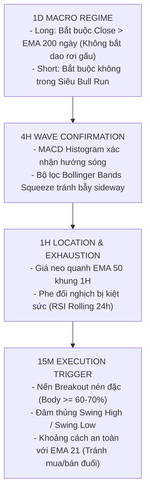

# MTF SNIPER QUANTITATIVE TRADING SUITE
> **Hệ thống Giao dịch Định lượng Đa Khung Thời Gian (Multi-Timeframe Sniper Suite)**  
> Thiết kế chuyên biệt cho thị trường Crypto Futures (Đòn bẩy 10x, Cặp BTC/USDT:USDT & ETH/USDT:USDT)  
> Khung thời gian cơ sở: **15M** | Khung phân tích xu hướng: **1H – 4H – 1D**

---

## 📑 MỤC LỤC
1. [Tổng Quan Hệ Thống & Bản Chất Lợi Nhuận](#1-tổng-quan-hệ-thống--bản-chất-lợi-nhuận)
2. [Cấu Trúc Thư Mục](#2-cấu-trúc-thư-mục)
3. [Triết Lý & Kiến Trúc Đa Khung Thời Gian (MTF Architecture)](#3-triết-lý--kiến-trúc-đa-khung-thời-gian-mtf-architecture)
4. [Quy Tắc Kỹ Thuật Vào Lệnh (Entry Rules)](#4-quy-tắc-kỹ-thuật-vào-lệnh-entry-rules)
5. [Quy Trình Quản Trị Vị Thế & Thoát Lệnh (Exits & Stoploss)](#5-quy-trình-quản-trị-vị-thế--thoát-lệnh-exits--stoploss)
6. [Hệ Thống Phòng Thủ Rủi Ro Cấp Tổ Chức (Risk Controls)](#6-hệ-thống-phòng-thủ-rủi-ro-cấp-tổ-chức-risk-controls)
7. [Bảng Cấu Hình Tham Số Thực Tế (Parameters)](#7-bảng-cấu-hình-tham-số-thực-tế-parameters)
8. [Báo Cáo Kiểm Toán Hiệu Năng Thực Tế (2022 – 2026)](#8-báo-cáo-kiểm-toán-hiệu-năng-thực-tế-2022--2026)
9. [Hướng Dẫn Vận Hành & Khuyến Nghị Vốn Thật](#9-hướng-dẫn-vận-hành--khuyến-nghị-vốn-thật)

---

## 1. TỔNG QUAN HỆ THỐNG & BẢN CHẤT LỢI NHUẬN

Bộ chiến lược **MTF Sniper** là hệ thống giao dịch thuật toán theo trường phái **Convex Trend-Following Breakout (Bắt Sóng Lệch Chuẩn)**:

* **Không phải Scalping thắng đều hàng ngày:** Hệ thống không tìm kiếm các khoản lãi nhỏ li ti mỗi ngày với tỷ lệ thắng 80%.
* **Cơ chế sinh lời:** Chấp nhận tỷ lệ thắng quanh **$50\%$**, hòa vốn hoặc lỗ nhỏ có kiểm soát ở đa số các lệnh. Toàn bộ lợi nhuận ròng được tạo ra bởi **các lệnh ăn trọn sóng lớn $+7\%$ đến $+10\%$ chart (tức $+70\%$ đến $+100\%$ ROE với đòn bẩy 10x)**.
* **Các chiến lược thành phần:**
  1. **[`StrategyMTFSniper.py`](file:///Users/nathan/Documents/WORK/freqtrade/strategies/active/StrategyMTFSniper.py)**: Bản hai chiều (LONG + SHORT), có cơ chế lọc xu hướng ngày để cấm Long trong thị trường gấu và cấm Short trong thị trường siêu tăng.
  2. **[`StrategyMTFShortSniper.py`](file:///Users/nathan/Documents/WORK/freqtrade/strategies/active/StrategyMTFShortSniper.py)**: Bản độc lập chuyên biệt chỉ đánh vị thế SHORT.

> [!WARNING]
> **Đặc tính chu kỳ vốn (Drawdown Profile):**
> Hệ thống sinh lời cực mạnh trong các giai đoạn thị trường có sóng biến động lớn (như 2025–2026). Trong các chu kỳ thị trường đi ngang kéo dài (như 2022–2023), hệ thống sẽ trải qua giai đoạn sụt giảm tài khoản khoảng **$29.7\%$** kéo dài hơn 1 năm. Nhà đầu tư cần hiểu rõ bản chất này trước khi cấp vốn.

---

## 2. CẤU TRÚC THƯ MỤC

```text
strategies/
├── active/
│   ├── StrategyMTFSniper.py          # Chiến lược 2 chiều chính (LONG + SHORT)
│   ├── StrategyMTFSniper.json        # Tham số tối ưu cho StrategyMTFSniper
│   ├── StrategyMTFShortSniper.py     # Chiến lược chuyên Short độc lập
│   ├── StrategyMTFShortSniper.json   # Tham số cho StrategyMTFShortSniper
│   └── MTF_Short_Sniper.pine         # Script TradingView Pine v5 hiển thị biểu đồ
├── drafts/                           # Các bản nháp thử nghiệm ý tưởng
└── README.md                         # Tài liệu hướng dẫn kỹ thuật toàn diện
```

---

## 3. TRIẾT LÝ & KIẾN TRÚC ĐA KHUNG THỜI GIAN (MTF ARCHITECTURE)



---

## 4. QUY TẮC KỸ THUẬT VÀO LỆNH (ENTRY RULES)

### A. Nhánh SHORT Sniper (Bán Khống)
1. **Khung 1D (Vĩ mô):** Không nằm trong sóng Siêu Bull Run (`close > ema_50 > ema_200 & rsi > 60`).
2. **Khung 4H (Xác nhận):** Không có sóng hồi tăng ngược chiều (`is_bull_wave_4h == 0`).
3. **Khung 1H (Vị thế):** Giá tiệm cận hoặc dưới EMA 50 1H (`loc_tolerance = 0.991`), RSI 1H trong 24h qua từng chạm vùng kiệt sức Bò ($\ge 55.1$).
4. **Khung 15M (Kích hoạt):** Nến đỏ thân đặc ($\ge 62\%$ thân), đâm thủng Swing Low 17 nến, đóng dưới EMA 10 & EMA 21, cách EMA 21 không quá $1.0\%$.

### B. Nhánh LONG Sniper (Mua Bứt Phá)
1. **Khung 1D (Vĩ mô):** Cấm Long khi khung Ngày rơi vào Death Cross hoặc dưới EMA 200 (`close < ema_200`). Giá không dãn quá $50\%$ so với EMA 200 ngày (`overextended <= 0.50`).
2. **Khung 4H (Xác nhận):** MACD Histogram 4H $> 0$.
3. **Khung 1H (Vị thế):** Giá trên EMA 50 1H, RSI 1H trong 24h từng có nhịp rũ kiệt sức ($\le 48.9$).
4. **Khung 15M (Kích hoạt):** Nến xanh thân đặc ($\ge 70\%$ thân), vượt Swing High 15 nến, đóng trên EMA 10 & EMA 21, RSI 15M $\le 70.4$, cách EMA 21 không quá $1.0\%$.

---

## 5. QUY TRÌNH QUẢN TRỊ VỊ THẾ & THOÁT LỆNH (EXITS & STOPLOSS)

> [!IMPORTANT]
> **Quy định kiến trúc về Exit Signals:**
> Cờ `use_exit_signal` được khóa cố định ở trạng thái **`False`**. 
> Kiểm toán thực nghiệm đã chứng minh: các cơ chế cắt non sau 2 tiếng (`exit_trend_invalidated`) trên khung 15m phá hủy **$-2,400\text{ USDT}$** và bóp chết $16/18$ lệnh ăn sóng lớn. Do đó, việc quản trị vị thế được giao hoàn toàn cho **`custom_stoploss`** và bảng **`minimal_roi`**.

1. **Cắt lỗ ban đầu (Hard Stoploss):**
   * BTC: $-2.5\%$ chart (tương đương $-25\%$ ROE với đòn bẩy 10x).
   * ETH: $-2.8\%$ chart (tương đương $-28\%$ ROE với đòn bẩy 10x).
2. **Khóa hòa vốn sớm (Breakeven Lock):**
   * Khi lãi chưa thực hiện đạt **$+2.0\%$ chart** ($+20\%$ ROE), hệ thống tự động dời Stoploss về **$+0.2\%$ chart** ($+2\%$ ROE) để bảo vệ tuyệt đối vốn gốc.
3. **Trailing Stop bám sát đỉnh/đáy:**
   * Khi lãi đạt **$+3.5\%$ chart** ($+35\%$ ROE), hệ thống kích hoạt Trailing Stop bám sát khoảng cách **$2.0\%$ chart** từ mức giá cao nhất.
4. **Thắt chặt sau 24 giờ:**
   * Nếu sau 24 giờ vị thế vẫn đang âm vốn, Stoploss được tự động siết về $-0.5\%$ chart để giảm thiểu thiệt hại kẹt vốn.
5. **Chốt lời mục tiêu cố định (Take Profit):**
   * Theo bảng ROI: Chốt $+10.0\%$ chart trong 12 giờ đầu, $+8.0\%$ sau 12 giờ, và $+7.0\%$ sau 24 giờ ($+70\%$ đến $+100\%$ ROE).

---

## 6. HỆ THỐNG PHÒNG THỦ RỦI RO CẤP TỔ CHỨC (RISK CONTROLS)

1. **Streak Circuit Breaker (Cắt cầu dao chuỗi thua):**
   * Tự động theo dõi các lệnh đã đóng trong lịch sử qua hook `confirm_trade_entry`.
   * Nếu phát hiện **3 lệnh thua lỗ thực tế liên tiếp** (mỗi lệnh lỗ $\ge 10\%$ ROE), hệ thống **tự động đóng băng mở lệnh mới trong 72 giờ**.
2. **Portfolio Correlation Guard (Chặn tích tụ rủi ro đồng pha):**
   * BTC và ETH có tương quan giá cao ($> 0.85$). Nếu lệnh thứ nhất đang mở và bị âm vốn **$> 0.8\%$ chart** ($-8\%$ ROE), hệ thống **tuyệt đối từ chối mở thêm lệnh thứ 2 cùng pha**, triệt tiêu nguy cơ sụt giảm kép (Double Drawdown).

---

## 7. BẢNG CẤU HÌNH THAM SỐ THỰC TẾ (PARAMETERS)

Được lưu trữ đồng bộ trong [`StrategyMTFSniper.json`](file:///Users/nathan/Documents/WORK/freqtrade/strategies/active/StrategyMTFSniper.json):

```json
{
  "strategy_name": "StrategyMTFSniper",
  "params": {
    "roi": {
      "0": 1.0,
      "720": 0.7
    },
    "stoploss": {
      "stoploss": -0.28
    },
    "max_open_trades": {
      "max_open_trades": 2
    },
    "buy": {
      "block_1d_counter_wave": true,
      "block_4h_counter_wave": true,
      "short_candle_body_ratio_min": 0.62,
      "short_cooldown_candles": 96,
      "short_loc_tolerance_1h": 0.991,
      "short_lookback_support": 17,
      "short_max_dist_ema21": 1.0,
      "short_min_1h_rsi_exhaustion": 55.1,
      "short_min_rsi_entry": 27.8,
      "long_candle_body_ratio_min": 0.7,
      "long_cooldown_candles": 42,
      "long_loc_tolerance_1h": 0.989,
      "long_lookback_resistance": 15,
      "long_max_1h_rsi_exhaustion": 48.9,
      "long_max_dist_ema21": 1.0,
      "long_max_rsi_entry": 70.4,
      "long_overextended_dist_max": 0.5,
      "long_block_1d_macd": true
    }
  }
}
```

---

## 8. BÁO CÁO KIỂM TOÁN HIỆU NĂNG THỰC TẾ (2022 – 2026)

* **Dữ liệu:** Toàn diện 5 năm lịch sử (01/01/2022 – 09/11/2026 = 1,773 ngày)
* **Dữ liệu làm ấm:** Bổ sung nến từ 2020 để EMA 200D chuẩn xác 100%
* **Thiết lập:** Vốn 1,000 USDT | Kích thước lệnh 150 USDT | Đòn bẩy 10x

### Bảng Chỉ Số Thực Tế
| Chỉ Số Đo Lường | Kết Quả Thực Nghiệm | Nhận Xét Kỹ Thuật |
| :--- | :---: | :--- |
| **Tổng lợi nhuận ròng** | **+1,599.84 USDT (+159.98% ROI)** | Vốn tăng từ 1,000$ lên 2,599.84$ |
| **Lợi nhuận gộp / Lỗ gộp** | 5,887.89$ / 4,288.05$ | **Profit Factor = 1.37** |
| **Tỷ lệ thắng (Win Rate)** | **49.68%** (154 Thắng / 156 Thua) | Gần cân bằng 1 thắng / 1 thua |
| **Payoff Ratio Thực Tế** | **1.39 lần** | Lãi TB: 38.2$ / Lỗ TB: 27.5$ |
| **Đáy rút vốn tối đa (Max Drawdown)** | **29.73% (342.90 USDT)** | Diễn ra trong giai đoạn 06/2022 – 06/2023 |
| **Thời gian Drawdown lâu nhất** | **368 ngày 12 giờ** | Giai đoạn đi ngang sau cú sập LUNA/FTX |
| **Tỷ số Calmar chuẩn quỹ (CAGR / DD)** | **0.73** | Chuẩn quỹ định lượng (~0.73) |
| **Tỷ số Sharpe (Daily)** | **0.89** | Độ biến động của số dư tài khoản |

### Phân Bổ Từng Năm
| Năm | Tổng Lệnh (WR) | Nhánh SHORT | Nhánh LONG | **TỔNG LÃI NĂM** | Đánh Giá |
| :---: | :---: | :---: | :---: | :---: | :--- |
| **2022** | 50 lệnh (58.0%) | **+94.03$** (49) | -21.06$ (1) | **+72.97$** | Nhánh Short gánh toàn bộ danh mục |
| **2023** | 32 lệnh (34.4%) | -81.35$ (13) | **+16.80$** (19) | **-64.55$** | **Năm duy nhất bị âm:** Thị trường sideway sau FTX |
| **2024** | 57 lệnh (43.9%) | +31.83$ (28) | **+89.54$** (29) | **+121.36$** | Sóng ETF: Nhánh Long dẫn đầu lợi nhuận |
| **2025** | 78 lệnh (53.8%) | **+290.93$** (60) | **+296.40$** (18) | **+587.33$** | **Cả 2 nhánh cùng thắng lớn** |
| **2026** | 60 lệnh (61.7%) | **+963.09$** (56) | +2.04$ (4) | **+965.13$** | Sóng sập mạnh: Nhánh Short áp đảo |
| **TỔNG** | **310 lệnh (49.7%)** | **+1,298.53$** | **+301.31$** | **+1,599.84$** | **4/5 năm có lãi dương** |

---

## 9. HƯỚNG DẪN VẬN HÀNH & KHUYẾN NGHỊ VỐN THẬT

### Khuyến Nghị Vận Hành
1. **Chưa nên cấp vốn lớn ngay lập tức:** Cần chạy Dry-Run (Paper Trading) tối thiểu 3 đến 6 tháng trên Binance Futures để kiểm chứng độ trượt giá thực tế và khớp lệnh.
2. **Quy mô vốn an toàn:**
   * Với vốn $1,000\text{ USDT}$, nên đặt kích thước lệnh từ **$50 - 75\text{ USDT}$** (thay vì $150\text{ USDT}$) để nén Max Drawdown thực tế xuống dưới ngưỡng an toàn $10\% - 12\%$.

### Các Lệnh CLI Chuẩn
```bash
# 1. Chạy Backtest chuẩn với config đã đồng bộ:
.venv/bin/freqtrade backtesting --config user_data/config.json --strategy StrategyMTFSniper --timerange 20220101-20261109

# 2. Chạy Dry-Run (Paper Trading) thử nghiệm:
.venv/bin/freqtrade trade --config user_data/config.json --strategy StrategyMTFSniper
```
