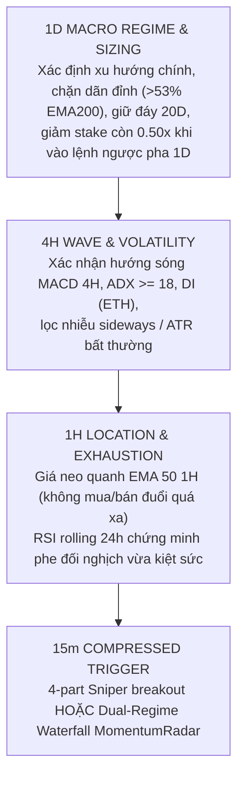

# MTF SNIPER QUANTITATIVE TRADING SUITE

> **Hệ thống Giao dịch Định lượng Đa Khung Thời Gian (Multi-Timeframe Sniper Suite)**  
> **Version hiện hành:** `4.6.0-counter1d` ([`strategies/mtf_sniper/__init__.py`](mtf_sniper/__init__.py))  
> Thiết kế chuyên biệt cho Crypto Futures (**10x Isolated**, cặp `BTC/USDT:USDT` & `ETH/USDT:USDT`)  
> Khung cơ sở: **15m** | Khung phân tích xu hướng: **1H – 4H – 1D**

---

## 📑 MỤC LỤC

1. [Tổng Quan & Triết Lý Định Hình Hệ Thống](#1-tổng-quan--triết-lý-định-hình-hệ-thống)
2. [Cấu Trúc Thư Mục Hiện Hành](#2-cấu-trúc-thư-mục-hiện-hành)
3. [Phễu Lọc Đa Khung Thời Gian (1D → 4H → 1H → 15m)](#3-phễu-lọc-đa-khung-thời-gian-1d--4h--1h--15m)
4. [Hai Cơ Chế Vào Lệnh: Sniper Setup & Waterfall Collapse](#4-hai-cơ-chế-vào-lệnh-sniper-setup--waterfall-collapse)
5. [Triết Lý Thoát Lệnh & Ratchet Stoploss](#5-triết-lý-thoát-lệnh--ratchet-stoploss)
6. [Quản Trị Rủi Ro Danh Mục & Counter-1D Sizing](#6-quản-trị-rủi-ro-danh-mục--counter-1d-sizing)
7. [Chuẩn Hoá Cấu Hình 3 Tầng](#7-chuẩn-hoá-cấu-hình-3-tầng)
8. [Kiểm Toán Hiệu Năng 5 Năm (2022 – 2026)](#8-kiểm-toán-hiệu-năng-5-năm-2022--2026)
9. [Vận Hành & Lệnh CLI](#9-vận-hành--lệnh-cli)

---

## 1. TỔNG QUAN & TRIẾT LÝ ĐỊNH HÌNH HỆ THỐNG

Bộ chiến lược **MTF Sniper** được xây dựng theo triết lý **Convex Asymmetric Trend-Following Breakout** *(xem bản kỹ thuật đầy đủ bằng tiếng Anh tại [`mtf_sniper/docs/PHILOSOPHY.md`](mtf_sniper/docs/PHILOSOPHY.md))*:

- **Không đánh scalping lặt vặt mỗi ngày:** Hệ thống chấp nhận Win Rate thực tế quanh **`55%`** và bỏ qua thị trường đi ngang nhiễu loạn. Nguồn lợi nhuận chính đến từ **phần đuôi lệch phải (right-tail convex payoff)**: cắt lỗ/hòa vốn nhanh khi sai kịch bản, và giữ trọn các con sóng lớn `+50%` tới `+120%+ ROE` (đòn bẩy 10x).
- **Khung nhỏ không đứng một mình (*Regime != Trigger*):** Một cây nến breakout 15m đẹp không có giá trị nếu đi ngược pha 1D/4H hoặc đâm đầu vào vùng kiệt sức 1H. Lệnh phải đi qua đủ **4 tầng lọc từ vĩ mô xuống vi mô**.
- **Quy tắc tất định làm lõi, AI là lớp phụ trợ tuỳ chọn:** Lõi tín hiệu, policy và phòng thủ danh mục chạy hoàn toàn tất định (`JEV_MODE=native` trong backtest). Ở production Docker (`decision_external`), JEV Decision chỉ đóng vai trò chấm điểm bổ trợ (`w_ai=0.10`, fallback về `native` khi timeout); đường JEV Hunter đang tắt mặc định ở pipeline live.

---

## 2. CẤU TRÚC THƯ MỤC HIỆN HÀNH

```text
strategies/
├── mtf_sniper/                         # Package chiến lược chính (StrategyMTFSniper)
│   ├── __init__.py                     # STRATEGY_VERSION = "4.6.0-counter1d"
│   ├── strategy_mtf_sniper.py          # Facade mỏng nối Freqtrade callbacks + auto-sync 15s
│   ├── strategy_mtf_sniper.json        # Tham số hyperopt / entry mặc định
│   ├── core/                           # Config 3 tầng, RuntimeMode, Contracts, CandidateID
│   ├── market/                         # Tính chỉ báo 1D / 4H / 1H / 15m (anti-lookahead)
│   ├── signals/                        # Sniper parts, SensorSuite, MomentumRadar (Waterfall)
│   ├── directional/                    # LongPolicy & Dual-Regime ShortPolicy (tách biệt)
│   ├── execution/                      # EntryPipeline & ExitPolicy (trend-runner deferral)
│   ├── risk/                           # RiskEngine, PositionSizing (0.50x), StoplossLadder, CB
│   ├── intelligence/                   # JEV Decision adapter/engine (native / hybrid external)
│   ├── telemetry/                      # DecisionLedger & TradeLedger (JSONL xoay vòng 10 MiB)
│   └── docs/                           # PHILOSOPHY.md, ARCHITECTURE.md, DATA_CONTRACTS.md
├── archive/                            # Chiến lược cũ (StrategyMTFShortSniper, v1/v2...)
├── drafts/                             # Bản nháp thử nghiệm ý tưởng
└── README.md                           # Tài liệu tổng quan chiến lược
```

---

## 3. PHỄU LỌC ĐA KHUNG THỜI GIAN (`1D -> 4H -> 1H -> 15m`)



---

## 4. HAI CƠ CHẾ VÀO LỆNH: SNIPER SETUP & WATERFALL COLLAPSE

### A. Complete Sniper 4-Part Setup (`long_A80_plus`, `short_A80_plus` / `B65_plus` / `C_sub65`)
Chỉ kích hoạt khi cả **4 nhóm điều kiện** (`*_structure`, `*_mtf`, `*_macro*`, `*_safety`) cùng thoả mãn đồng thời:
- **Nến trigger 15m nén đặc:** thân nến chiếm $\ge 60\% - 63\%$ biên độ, hạn chế râu từ chối (`max_rejection_wick_ratio`), phá vỡ Swing High (15 nến) / Swing Low (17 nến), nằm đúng phía EMA10 & EMA21, không quá xa EMA21.
- **Vị thế 1H chuẩn xác:** SHORT nằm trong dải `[0.991x, 1.025x]` của `ema_50_1h` (chờ nhịp hồi kiệt sức Bò `rsi_max_24_1h >= 55.1` rồi mới đánh xuống); LONG bám `>= 0.988x` của `ema_50_1h` sau nhịp rũ (`rsi_min_24_1h <= 57.1`).
- **Bảo vệ vĩ mô 1D:** LONG đòi hỏi không rơi vào bear market 1D (`close > ema_50_1d` & `ema_200_1d`) và không dãn quá `+53%` trên EMA200 1D; SHORT đứng cách đáy 20 ngày ít nhất `3.5%` và tránh cao điểm capitulation.

### B. Dual-Regime Waterfall Momentum (`jev_hunter_waterfall_collapse`)
Sinh ra để bắt các cú sập tháo chạy nhanh (như `12/11/2026` và `20/11/2026` trên BTC) mà bộ lọc Sniper chuẩn bỏ qua vì giá đã đi xa `ema_50_1h` hoặc xuyên thẳng đáy 20D:
- **Regime A — Vacuum Breakdown (`floor_dist <= 0` hoặc `<= 0.5%` kèm `rel_vol >= 3.0x`):** Khi giá thủng hỗ trợ 20 ngày, cho phép Short theo động lượng vùng chân không (bỏ qua trần ATR thông thường), vẫn giữ trần quá bán climax (`dist_ema50_4h >= -10%`, `dist_ema50_1d >= -20%`).
- **Regime B — In-Range Collapse (`floor_dist > 0`):** Đánh gãy trước đáy khi biến động 4H mở rộng (`bb_width_4h >= 0.035`), chưa dãn sâu (`dist_ema50_4h >= -3.5%`, `dist_ema50_1d >= -12%`); riêng ETH bắt buộc dưới `ema_50_4h`.

---

## 5. TRIẾT LÝ THOÁT LỆNH & RATCHET STOPLOSS

`use_exit_signal` được giữ **`False`** có chủ đích — toàn bộ vòng đời thoát lệnh do [`stoploss_ladder.py`](mtf_sniper/risk/stoploss_ladder.py) và [`exit_policy.py`](mtf_sniper/execution/exit_policy.py) quản lý:

1. **Cắt lỗ gốc:** `-25%` ROE (BTC) / `-28%` ROE (ETH) ở đòn bẩy `10x`.
2. **Thang khoá lãi một chiều (Ratchet Ladder):**
   - Lãi `>= +18%` ROE -> dời SL lên khoá **`+1%` ROE** (hoà vốn dương).
   - Lãi `>= +30%` ROE -> khoá **`+10%` ROE**.
   - Lãi `>= +50%` ROE -> khoá **`+25%` ROE**, đồng thời **hoãn chốt ROI** nếu cấu trúc 1H vẫn thuận xu hướng (`close_1h > ema_21_1h` với Long, `<` với Short).
   - Lãi `>= +80%` ROE -> trailing mềm **`-25%`**.
   - Lãi `>= +120%` ROE -> trailing **`-20%`** (`minimal_roi`: `100%` tại `0m`, `70%` sau `720m`).
3. **Siết lệnh kẹt sau 24 giờ:** nếu giữ quá 24h mà vẫn âm (`< 0%` ROE), siết SL lên **`-5%` ROE** để thu hồi vốn nhanh.

---

## 6. QUẢN TRỊ RỦI RO DANH MỤC & COUNTER-1D SIZING

1. **Counter-1D Stake Scaling (`0.50x`):** Trong [`position_sizing.py`](mtf_sniper/risk/position_sizing.py), khi `enable_dynamic_sizing=True`, mọi lệnh **LONG ngược sóng 1D** (`macdhist_1d <= 0` hoặc `ema_50_1d <= ema_200_1d`) và lệnh **SHORT đi ngược Macro Bull Run 1D** (`is_macro_bull_run_1d == 1.0`) bị tự động hạ khối lượng xuống **`0.50x`** (`counter_1d_stake_scale`), giúp các cú hồi nhỏ gãy giữa chừng không phá tài khoản.
2. **Directional Lock:** Cấm mở Long và Short đối nghịch cùng lúc giữa BTC & ETH.
3. **Distress Guard (`-8%` ROE):** Đang có lệnh âm sâu $\le -8\%$ ROE -> cấm mở thêm vị thế mới.
4. **Streak Circuit Breaker:** `3` chuỗi thua liên tiếp độc lập (`<= -10%` ROE, gộp trùng BTC+ETH vào trong 1 giờ) -> tạm dừng bot **72 giờ** rồi reset bộ đếm.
5. **Live Exchange Position Auto-Sync (`15s`):** Ở live mode, [`bot_loop_start`](mtf_sniper/strategy_mtf_sniper.py#L298) làm mới `wallets` mỗi `15 giây` khi có vị thế mở để đồng bộ tức thì nếu người dùng đóng lệnh tay trên Binance.

---

## 7. CHUẨN HOÁ CẤU HÌNH 3 TẦNG

1. **Hyperopt / Strategy Parameters:** [`mtf_sniper/strategy_mtf_sniper.json`](mtf_sniper/strategy_mtf_sniper.json) + `Parameter` trên `StrategyMTFSniper` (gồm cả `counter_1d_stake_scale` `0.25..1.00`).
2. **Runtime / Deploy Overlay:** `strategy_params` trong [`user_data/config.json`](../user_data/config.json) & [`docker/config.mtf_sniper.json`](../docker/config.mtf_sniper.json) (`mtf_runtime_mode`, `enable_waterfall`, `enable_dynamic_sizing`, `exchange_sync_interval_secs`, `default_leverage`, `tag_multipliers`, `pair_overrides`).
3. **Environment Variables:** `MTF_RUNTIME_MODE`, `JEV_MODE`, `JEV_FAIL_POLICY`, `COUNTER_1D_STAKE_SCALE`, `EXCHANGE_SYNC_INTERVAL_SECS`... được gom về [`config_resolve.py`](mtf_sniper/core/config_resolve.py) kèm `EffectiveConfig.fingerprint()`.

---

## 8. KIỂM TOÁN HIỆU NĂNG 5 NĂM (`2022 – 2026`)

* **Khoảng thời gian:** `20220101–20261124` · **Cấu hình:** `1,000 USDT` gốc, `stake_amount=unlimited`, `tradable_balance_ratio=0.70`, `10x`, `enable_dynamic_sizing=true`, `counter_1d_stake_scale=0.50`, `JEV_MODE=native`, `--cache none`.

| Chỉ số | Trước `0.50x` (`1.0x` phẳng) | Bản `v4.6.0-counter1d` (`0.50x`) | Ghi chú |
|---|---:|---:|---|
| Tổng lệnh / Win Rate | `334` (`55.1%`) | `334` (`55.1%`) | `184W / 150L` |
| Lợi nhuận ròng | `+199,233.55 USDT` | **`+184,121.66 USDT`** (`+18,412.17%`) | Lãi kép cuối chu kỳ thấp hơn 7.6% |
| **Max Drawdown (wallet)** | `19.20%` (`31,728.48 USDT`) | **`14.42%` (`18,286.48 USDT`)** | **Giảm 42.4% theo USDT** |
| **Profit Factor / SQN** | `2.26` / `2.40` | **`2.56`** / **`2.67`** | Chất lượng kèo tăng rõ rệt |
| **Sharpe / Sortino / Calmar** | `1.49` / `1.88` / `1,109.39` | **`1.57`** / **`1.96`** / **`1,365.48`** | Tối ưu lợi nhuận trên rủi ro |

---

## 9. VẬN HÀNH & LỆNH CLI

```bash
# 1. Backtest local tất định (native):
PYTHONPATH=. JEV_MODE=native MTF_RUNTIME_MODE=deterministic \
  .venv/bin/freqtrade backtesting --config user_data/config.json \
  --strategy-path strategies/mtf_sniper --strategy StrategyMTFSniper \
  --timerange 20220101-20261124 --cache none

# 2. Chạy unit tests & guardrails:
.venv/bin/python scripts/lint_guardrails.py && .venv/bin/pytest -q tests/strategy/

# 3. Deploy Docker trên Pi / Coolify:
docker compose up -d --build
```
