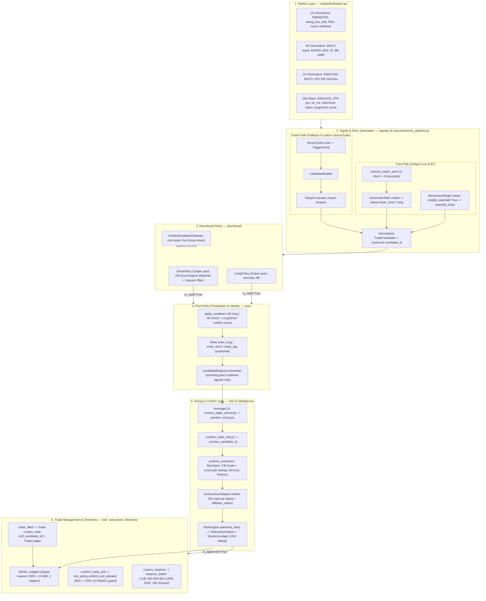

# MTF Sniper — System Architecture

**Package:** `strategies/mtf_sniper/` · **Version:** `STRATEGY_VERSION` in `__init__.py` (`4.5.0-waterfall`) · **Deploy:** Docker → `--strategy-path …/mtf_sniper`

**Invariant:** Layered modules. Legacy AND-mask rules are ported into layers; live entry always goes through `EntryPipeline` (never a strategy-facade short-circuit of Policy).

**Runtime profile:**
- **Local / Backtest (`deterministic`):** `JEV_MODE=native` heuristics, `enable_waterfall=true`, **Hunter OFF** (`EntryPipeline.live` forces `hunter_escalation=None`).
- **Docker Production (`decision_external`):** `JEV_MODE=external` Hybrid AI score (`w_ai=0.10`, `JEV_FAIL_POLICY=fallback_native`, timeout `4s`), `enable_waterfall=true`, `enable_dynamic_sizing=true`, **Hunter OFF**. See `STABILIZATION_DETERMINISTIC.md`.

**Source of truth:** this file + `DATA_CONTRACTS.md` describe **implemented** runtime. Historical migration notes live in `MIGRATION_PLAN.md` (P0–P4 archive).

---

## 0. Facade vs modules

Freqtrade calls the strategy; `StrategyMTFSniper` is a thin facade:

| Hook Freqtrade | Strategy role | Module |
|---|---|---|
| `populate_indicators_*` | MTF features (1D, 4H, 1H, 15m) | `market/indicators.py` |
| `populate_entry_trend` | Entry signals + cooldown + registry | `execution/entry_pipeline.py` |
| `leverage` / `custom_stake_amount` | Leverage (10x cap) + stake sizing | `risk/position_sizing.py` |
| `confirm_trade_entry` | Portfolio guards + JEV Decision + Decision Ledger | `intelligence/` + `risk/` |
| `custom_stoploss` | Profit-tier ladder + 24h loss timeout | `risk/stoploss_ladder.py` |
| `confirm_trade_exit` | Trend-runner ROI deferral (>=50% ROE vs 1H EMA21) | `execution/exit_policy.py` |
| `custom_exit` | Inactive stub (`use_exit_signal = False`) | `strategy_mtf_sniper.py` |
| `order_filled` | Candidate ID persist (`mtf_candidate_id`) + Trade Ledger | `core/candidate_*`, `telemetry/` |

**Signal principles:**

1. **Sensors** emit **part facts** only — never write `enter_*` / size / call JEV.
2. A complete sniper recipe (ALL-4 parts) becomes a `TradeCandidate` with `setup:sniper_*`.
3. When `enable_waterfall=True`, `MomentumRadar` also emits `waterfall_drop` short candidates into `ShortPolicy` (dual-regime Vacuum Breakdown / In-Range filters).
4. **Policy** decides **eligibility** (`is_valid`) and attaches a **quality grade** (informational for complete setups).
5. Incomplete parts ≠ entry.

---

## 1. Layered System Architecture (End-to-End Chart)



| Path | When | Layers executed |
|---|---|---|
| **Fast** | Preferred when part sensors match live suite | Parts → AND masks (+ `MomentumRadar` if `enable_waterfall`) → `TradeCandidate` → Policy |
| **Event** | Fallback / when suite ≠ part-only set | SensorSuite → Builder → SetupComposer → Policy |

Fast path **does not** call `CandidateBuilder` / `SetupComposer`. That is intentional (BT cost). Changes to Builder/Composer logic **must** keep fast-path construction + `tests/strategy/test_mtf_candidate_parity.py` green.

---

## 2. Policy: eligibility ≠ quality grade

| Field | Meaning |
|---|---|
| `PolicyEvaluationResult.is_valid` | Setup **eligibility** (may proceed to cooldown / `enter_*`) |
| `quality_grade` | Quality label — **does not** reject a complete sniper setup |
| Waterfall anomaly (`ShortPolicy`) | Enforces dual-regime + vacuum filters; `short_score > 0` floored at `0.70` so passing waterfalls are never dropped below missing-score (`0 -> 0.85`) |
| Decision Gate | Uses 32-bar trajectory + macro scores — **does not** read `quality_grade` |

A developer must **not** treat `quality_grade=REJECT` as “drop candidate” on complete sniper setups. See `STABILIZATION_DETERMINISTIC.md`.

---

## 3. Confirm, Sizing, Risk & Lifecycle

```mermaid
flowchart LR
  pop["populate_entry_trend"] -->|"enter_* + surviving registry"| size["leverage / custom_stake_amount"]
  size -->|"amount, rate"| conf["confirm_trade_entry"]
  conf -->|"guards + JEV detail + stake/equity"| auth["RiskEngine.authorize_entry"]
  auth -->|"is_approved"| fillIn["order_filled (entry)"]
  fillIn -->|"persist mtf_candidate_id"| hold["Open Trade"]
  hold -->|"each loop/candle"| sl["custom_stoploss (ladder)"]
  hold -->|"ROI exit check"| ex["confirm_trade_exit"]
  sl --> fillOut["order_filled (exit)"]
  ex --> fillOut
  fillOut -->|"MFE/MAE + PnL"| tlog["TradeLedger"]
```



**RiskEngine** serves two **different** Freqtrade surfaces (see `DATA_CONTRACTS.md` §3.5):

| Surface | What it does | What it does **not** |
|---|---|---|
| `confirm_trade_entry` → `authorize_entry` → `RiskAuthorization` | Portfolio guards + JEV Decision; records `est_stake` (`amount * rate / lev`), `wallet_equity`, `ai_confidence`, `market_regime`, `policy_score`; Strategy returns **`is_approved` only** | Allocate or override live order stake/leverage |
| `leverage()` / `custom_stake_amount()` | Return values Freqtrade applies (`get_leverage` / `get_stake_amount`) | Stop-distance risk budgeting |
| `custom_stoploss()` | Ladder via `get_stoploss()` (+18/+30/+50/+80/+120% ROE & 24h loss timeout) | Exchange SL outside FT callbacks |

Default Python stake path: `enable_dynamic_sizing=False` (1.0x multiplier); Docker/config overlay enables `enable_dynamic_sizing=true` (`_TAG_MULTIPLIERS` / `tag_multipliers` * `resolve_counter_1d_scale(..., counter_1d_stake_scale)` `0.50` default), capped by `max_stake`; leverage `min(default_leverage, max_leverage)` (`10.0` default). Config hierarchy (`config_resolve.py`): hyperopt/strategy Parameters (`strategy_mtf_sniper.json`) + runtime switches/overrides (`strategy_params` -> env -> defaults) captured into `EffectiveConfig.fingerprint()`.

---

## 4. Candidate ID lifecycle

```text
populate → cooldown/conflict filter → CandidateRegistry.remember (surviving bars only)
confirm / order_filled → lookup(registry, max-age 6h)
                      → else reconstruct from analyzed enter_* (same max-age)
                      → else candidate_id_missing
entry fill → Trade.set_custom_data(mtf_candidate_id) + RAM bind
exit fill  → prefer custom data → TradeLedger (bounded deque + 10 MiB rotation)
```

Never invent non-canonical IDs. Persisted IDs must match Trade pair/side.

---

## 5. Module map

| Layer | Role | Module |
|---|---|---|
| Market | MTF indicators (1D/4H/1H/15m) | `market/indicators.py` |
| Sensors | Part (+ anomaly catalog) facts | `signals/sensor_suite.py`, `signals/sensors/` |
| Builder | Merge / neutralize (event path) | `signals/candidate_builder.py` |
| Composer | Recipe ALL (event path) | `directional/setup_composer.py`, `setup_recipes.py` |
| Policy | Sniper eligibility + Waterfall dual-regime filters | `directional/*/policy.py`, `directional/*/setups.py` |
| Fast masks | Vectorized AND + `MomentumRadar` → candidate | `execution/entry_pipeline.py`, `signals/momentum_radar.py` |
| Hunter | **Not wired** on live | `intelligence/hunter_escalation.py` (kept) |
| Entry | Cooldown + conflict + surviving registry | `execution/entry_pipeline.py` |
| Decision | Native / External Hybrid (`fail_policy` synced) | `intelligence/decision_adapter.py`, `jev_decision.py` |
| Risk | Guards (non-overlapping + correlated-dedup CB), sizing, SL ladder | `risk/portfolio_protection.py`, `position_sizing.py`, `stoploss_ladder.py`, `risk_engine.py` |
| Exit | ROI trend-runner deferral (`confirm_exit_allowed`) | `execution/exit_policy.py` |
| Telemetry | Bounded JSONL ledgers + rotation | `telemetry/decision_ledger.py`, `trade_ledger.py`, `jsonl_io.py` |
| Sync | Live wallet/position refresh on interval (`bot_loop_start`) before exit/order sync | `strategy_mtf_sniper.py` (`exchange_sync_interval_secs`) |
| Identity | Canonical ID + registry | `core/candidate_id.py`, `candidate_registry.py` |
| Config | RuntimeMode fail-fast + EffectiveConfig fingerprint | `core/runtime_mode.py`, `config_resolve.py` |

Anomaly sensors exist in `SensorSuite.hunter()` / `full()` for future re-enable — **not** on `SensorSuite.live()`.

---

## 6. Do not regress

- Both fast and event paths feed the **same** Policy contract; parity tests required.
- Incomplete parts ≠ `enter_*`.
- `CandidateRegistry.remember` only records candidates surviving `apply_cooldown` and conflict cancellation.
- Circuit Breaker resets streak after triggering a pause window and deduplicates simultaneous cross-pair same-side entries (`portfolio_protection.py` handles `LocalTrade` `strategy == ""` for BT parity).
- Hunter stays off the live pipeline until an explicit re-enable project.
- Open/Closed: new recipes/parts via directional + sensors — not masks in the strategy facade.
- Contracts in `DATA_CONTRACTS.md` must match `core/contracts.py` (see contract tests).
