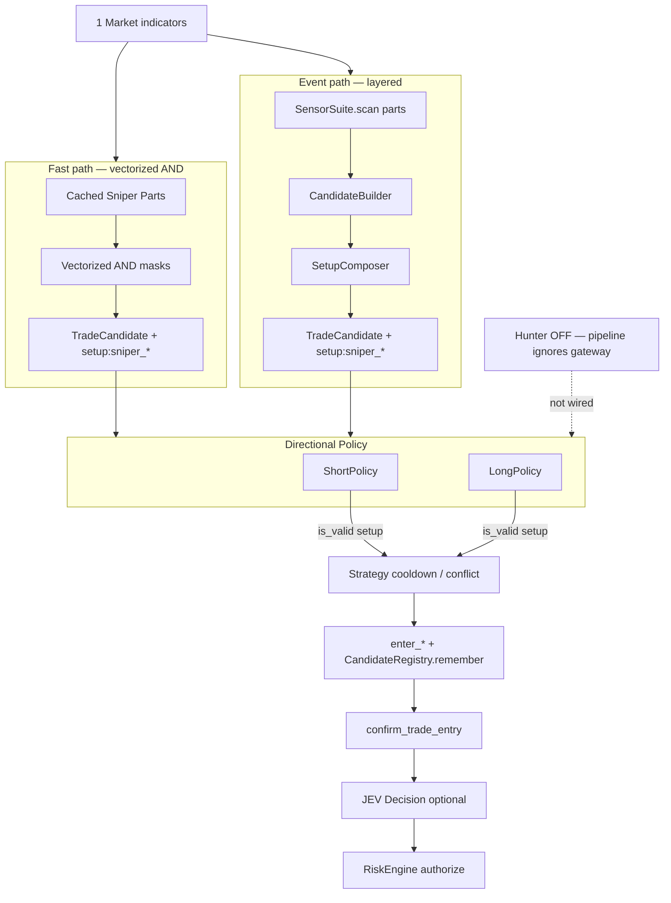

# MTF Sniper — System Architecture

**Package:** `strategies/mtf_sniper/` · **Version:** `STRATEGY_VERSION` in `__init__.py` (currently `4.4.1-deterministic`) · **Deploy:** Docker → `--strategy-path …/mtf_sniper`

**Invariant:** Layered modules. Legacy AND-mask rules are ported into layers; live entry always goes through `EntryPipeline` (never a strategy-facade short-circuit of Policy).

**Current phase:** Deterministic sniper (`mtf_runtime_mode=deterministic`). **Hunter OFF** on the live entry path (`EntryPipeline.live` forces `hunter_escalation=None`). Decision Gate may run **native** heuristics. See `STABILIZATION_DETERMINISTIC.md`.

**Source of truth:** this file + `DATA_CONTRACTS.md` describe **implemented** runtime. Historical migration notes live in `MIGRATION_PLAN.md` (P0–P4 archive).

---

## 0. Facade vs modules

Freqtrade calls the strategy; `StrategyMTFSniper` is a thin facade:

| Hook Freqtrade | Strategy role | Module |
|---|---|---|
| `populate_indicators_*` | MTF features | `market/indicators.py` |
| `populate_entry_trend` | Entry signals | `execution/entry_pipeline.py` |
| `confirm_trade_entry` | Decision + Risk **authorize** | `intelligence/` + `risk/` |
| `custom_stoploss` / `custom_exit` | SL ladder / exit | `risk/stoploss_ladder`, `execution/exit_policy` |
| `order_filled` | Candidate ID persist + Trade Ledger | `core/candidate_*`, `telemetry/` |

**Signal principles:**

1. **Sensors** emit **part facts** only — never write `enter_*` / size / call JEV.
2. A complete sniper recipe (ALL-4 parts) becomes a `TradeCandidate` with `setup:sniper_*`.
3. **Policy** decides **eligibility** (`is_valid`) and attaches a **quality grade** (informational).
4. Incomplete parts ≠ entry.

---

## 1. Two implementation paths, one contract

`ARCHITECTURE` historically showed a single Sensor→Builder→Composer chain. Live code has **two** implementations that must yield the **same** `TradeCandidate` / Policy contract:



| Path | When | Layers executed |
|---|---|---|
| **Fast** | Preferred when part sensors match live suite | Parts → AND masks → `TradeCandidate` **directly** → Policy |
| **Event** | Fallback / when suite ≠ part-only set | SensorSuite → Builder → SetupComposer → Policy |

Fast path **does not** call `CandidateBuilder` / `SetupComposer`. That is intentional (BT cost). Changes to Builder/Composer logic **must** keep fast-path construction + `tests/strategy/test_mtf_candidate_parity.py` green.

---

## 2. Policy: eligibility ≠ quality grade

| Field | Meaning |
|---|---|
| `PolicyEvaluationResult.is_valid` | Setup **eligibility** (may proceed to cooldown / `enter_*`) |
| `quality_grade` | Quality label — **does not** alone reject an eligible setup |
| Decision Gate | Uses candle/macro scores — **does not** read `quality_grade` |

A developer must **not** treat `quality_grade=REJECT` as “drop candidate” at Policy. See `STABILIZATION_DETERMINISTIC.md`.

---

## 3. Confirm → Decision → Risk (honest scope)

```
confirm_trade_entry
  → resolve candidate_id (registry → DF fallback w/ max-age → else missing)
  → RiskEngine.authorize_entry
       → portfolio guards (circuit / directional / distress / max open)
       → optional JevDecisionAdapter
       → RiskAuthorization
  → strategy returns bool(auth.is_approved) only
```

**RiskEngine today** = portfolio **authorization gate** + stoploss ladder helper.

| Does | Does **not** (yet) |
|---|---|
| Max open / circuit / directional lock / distress | Stop-distance risk budgeting |
| Fill `RiskAuthorization` metadata fields | Drive Freqtrade stake/leverage from `auth.*` |
| `custom_stoploss` → `get_stoploss()` | Own exchange SL placement outside FT callbacks |

**Confirm path today:** Strategy returns only `auth.is_approved`. It does **not** pass `proposed_stake` / `max_stake`, so `auth.stake_amount` is typically **`0.0`** and `auth.leverage` is the configured max-leverage metadata — not the live order size. Details: `DATA_CONTRACTS.md` §3.5.
---

## 4. Candidate ID lifecycle

```
populate → CandidateRegistry.remember
confirm / order_filled → lookup(registry, max-age 6h)
                      → else reconstruct from analyzed enter_* (same max-age)
                      → else candidate_id_missing
entry fill → Trade.set_custom_data(mtf_candidate_id) + RAM bind
exit fill  → prefer custom data → ledger
```

Never invent non-canonical IDs. Persisted IDs must match Trade pair/side.

---

## 5. Module map

| Layer | Role | Module |
|---|---|---|
| Market | MTF indicators | `market/indicators.py` |
| Sensors | Part (+ anomaly catalog) facts | `signals/sensor_suite.py`, `signals/sensors/` |
| Builder | Merge / neutralize (event path) | `signals/candidate_builder.py` |
| Composer | Recipe ALL (event path) | `directional/setup_composer.py`, `setup_recipes.py` |
| Policy | Eligibility + grade/tag | `directional/*/policy.py` |
| Fast masks | Vectorized AND → candidate | `execution/entry_pipeline.py` |
| Hunter | **Not wired** on live | `hunter_escalation.py` (kept) |
| Entry | Cooldown + conflict + registry | `execution/entry_pipeline.py` |
| Decision / Risk | Confirm · authorize · SL · exit | `intelligence/`, `risk/` |
| Identity | Canonical ID + registry | `core/candidate_id.py`, `candidate_registry.py` |

Anomaly sensors exist in `SensorSuite.hunter()` / `full()` for future re-enable — **not** on `SensorSuite.live()`.

---

## 6. Do not regress

- Both fast and event paths feed the **same** Policy contract; parity tests required.
- Incomplete parts ≠ `enter_*`.
- Hunter stays off the live pipeline until an explicit re-enable project.
- Open/Closed: new recipes/parts via directional + sensors — not masks in the strategy facade.
- Contracts in `DATA_CONTRACTS.md` must match `core/contracts.py` (see contract tests).
