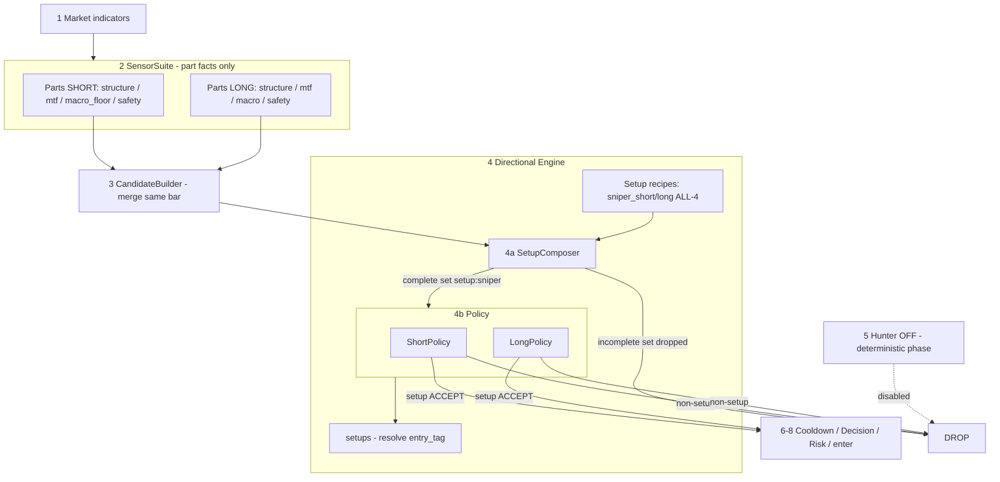

# MTF Sniper — System Architecture
**Package:** `strategies/mtf_sniper/` · **Version:** see `strategies/mtf_sniper/__init__.py` (`STRATEGY_VERSION`) · **Deploy:** Docker → `--strategy-path …/mtf_sniper`

**Invariant:** Redesign = clean layered modules. Legacy AND-mask rules are **ported into layers**, never short-circuit `apply_entry_pipeline`.

**Current phase:** Deterministic sniper only (`mtf_runtime_mode=deterministic`). **Hunter OFF** on the entry path. Decision Gate may run **native** heuristics only (no external AI). See `STABILIZATION_DETERMINISTIC.md`.

---

## 0. Hệ thống mới là gì?

Freqtrade gọi strategy theo vòng nến. `StrategyMTFSniper` là facade:

| Hook Freqtrade | Việc strategy làm | Module thật |
|---|---|---|
| `populate_indicators_*` | Tính MTF features | `market/indicators.py` |
| `populate_entry_trend` | Sinh tín hiệu vào lệnh | `execution/entry_pipeline.py` |
| `confirm_trade_entry` | Decision + Risk authorize | `jev_decision` + `risk/` |
| `custom_stoploss` / `custom_exit` | SL ladder / exit rules | `risk/stoploss_ladder`, `execution/exit_policy` |

**Nguyên tắc tín hiệu:**

1. **Sensor** chỉ bắn **tín hiệu đơn** (part / anomaly) — chưa phải strategy, chưa `enter_*`.
2. **Directional 4a SetupComposer** thu thập sensor cùng bar, match **recipe ALL** = rule AND-mask cũ.
3. **Đủ một bộ** → gắn `setup:sniper_*` → **4b Policy** grade/tag → ACCEPT → entry.
4. **Thiếu bộ** → không entry.

Đường đi: **Sensor → Builder → SetupComposer → Policy → Entry → Decision → Risk**.

---

## 1. Pipeline tổng thể

---

## 2. Workflow từng bước

### Bước 1 — Market / indicators

`populate_indicators_*` ghi feature MTF lên dataframe. Chưa quyết định trade.

### Bước 2 — SensorSuite (detection only)

`SensorSuite.live(strategy)` đăng ký **flat**:

| Sensor | Loại | Emit khi |
|---|---|---|
| `short_structure` / `short_mtf` / `short_macro_floor` / `short_safety` | Part PATTERN | Slice AND-mask short |
| `long_structure` / `long_mtf` / `long_macro` / `long_safety` | Part PATTERN | Slice AND-mask long |

Anomaly (`volume_surge` / `volatility_expansion` / `waterfall_drop`) **không** đăng ký live — không xuống Builder/Policy. Còn trong `SensorSuite.hunter()` / `full()` cho lúc bật lại AI.

Part builders: `directional/*/setups.py` (`build_*_sniper_parts`). Mono `sniper_*_mask` = AND(parts) — diagnostics only.

**Cấm** sensor ghi `enter_*` / size / gọi JEV.

### Bước 3 — CandidateBuilder

Cùng bar + cùng side → merge `sensors[]`. Opposite side: chỉ neutralize khi **cả hai** đủ recipe sniper; nếu đúng một side đủ bộ thì giữ side đó (bỏ ambient parts phía kia). Live builder cooldown = 0 (strategy `apply_cooldown` owns spacing).

### Bước 4 — Directional Engine

| Phần | Module | Việc |
|---|---|---|
| Setup recipes | `directional/setup_recipes.py` | `sniper_short` / `sniper_long` = frozenset 4 parts |
| **4a SetupComposer** | `directional/setup_composer.py` | Đủ bộ → `primary_sensor=setup:sniper_*`, `setup_complete=True`. Incomplete part-only → drop |
| **4b Short/Long Policy** | `directional/*/policy.py` | Setup complete → grade + `entry_tag` ACCEPT. Non-setup → reject (`deterministic_only`) |
| setups resolve | `directional/*/setups.py` | Map → `short_A80plus` / B65 / C / `long_A80plus` |
| Engine facade | `directional/engine.py` | Route theo side |

**Parity AND-mask cũ:** đủ 4 parts trên bar ⇔ `build_raw_sniper_*_mask`.

### Bước 5 — Hunter / Anomaly (OFF)

Anomaly không có trên `SensorSuite.live`. Entry pipeline `hunter_escalation=None`. Composer drop mọi candidate không đủ recipe.

### Bước 6–8 — Cooldown, Decision, Risk

Strategy cooldown + conflict → `enter_*`. `confirm_trade_entry` vẫn có Decision Gate + Risk (tách khỏi Hunter entry escalation).

---

## 3. Ví dụ deterministic sniper short

1. Nến 15m: 4 part short đều fire → Builder merge `sensors=[short_structure,…]`.
2. SetupComposer: recipe ALL thỏa → `setup:sniper_short`, `short_score=85`.
3. ShortPolicy ACCEPT → `entry_tag=short_A80plus`.
4. Cooldown OK → `enter_short=1`.

Thiếu một part → Composer drop / không setup → không entry.

---

## 4. Tầng & module

| Tầng | Vai trò | Module |
|---|---|---|
| 1. Market | Indicators MTF | `market/indicators.py` |
| 2. Sensors | Fact đơn (parts + anomaly) | `signals/sensor_suite.py`, `signals/sensors/` |
| 3. Builder | Merge / neutralize | `signals/candidate_builder.py` |
| 4a. Composer | Recipe ALL = strategy cũ | `directional/setup_composer.py`, `setup_recipes.py` |
| 4b. Policy | ACCEPT setup / reject khác | `directional/*/policy.py` |
| 5. Hunter | **Disabled** this phase | `hunter_escalation.py` (kept for later) |
| 6. Entry | Cooldown + conflict | `execution/entry_pipeline.py` |
| 7–8. Decision / Risk | Confirm · size · SL · exit | `intelligence/jev_decision.py`, `risk/` |

`CompositeSensor` vẫn tồn tại cho thí nghiệm anomaly; **không** dùng làm live sniper wrapper.

---

## 5. Sensor vs Directional

| | Sensor | Directional 4a+4b |
|---|---|---|
| Emit | Tín hiệu đơn | — |
| Combine | Không | Recipe ALL trên `sensors[]` |
| Quyết định entry | Không | Policy ACCEPT setup only |
| AND-mask cũ | Mỗi điều kiện = 1 part | Đủ bộ = mask |

---

## 6. Do not regress

- Một `EntryPipeline` path — không short-circuit layers.
- Part AND == mono mask (tests).
- Incomplete parts ≠ `enter_*`.
- Open/Closed: thêm recipe/part qua directional + part sensor; không nhét mask vào strategy facade.
