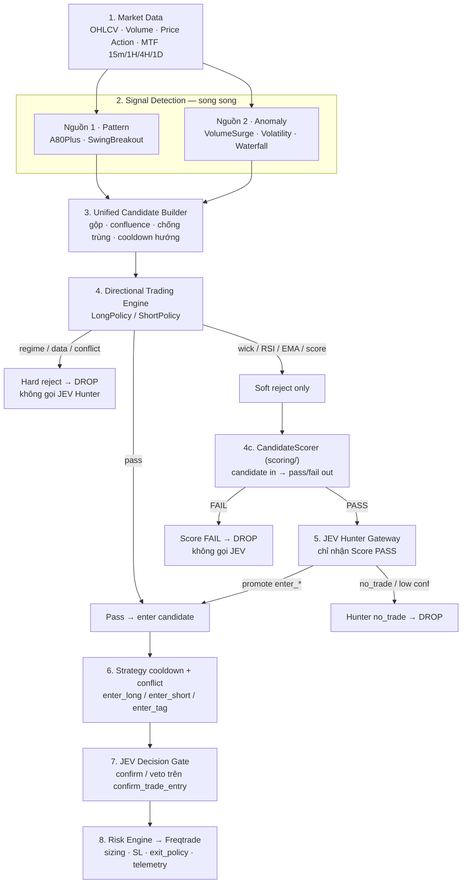
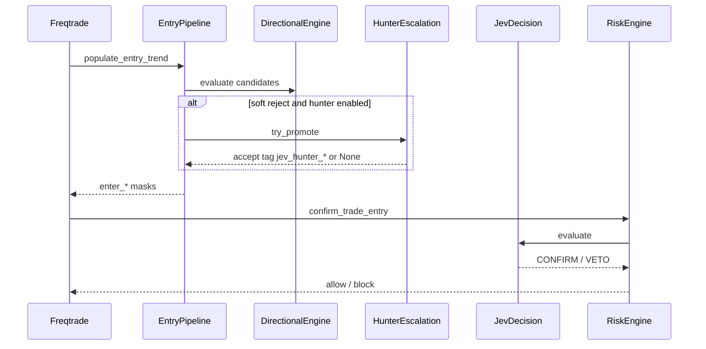

# MTF Sniper — System Architecture
**Package:** `strategies/mtf_sniper/` · **Version:** 4.1.2-scoring · **Deploy:** Docker → `--strategy-path …/mtf_sniper`

Tài liệu mô tả pipeline vận hành và map sang module đang chạy.

---

## 1. Pipeline tổng thể (đọc từ trên xuống)



**Ý chính:** Sensor → Builder → Policy.  
- **Pass** → entry.  
- **Hard-fail** → DROP, không AI.  
- **Soft-fail** → **`CandidateScorer`** (module `scoring/`, 1 candidate → pass/fail) → FAIL drop / PASS mới gọi **JEV Hunter**.  
- Hunter promote → entry; **JEV Decision** vẫn confirm/veto lúc vào lệnh.

---

## 2. Tầng & module

| Tầng | Việc làm | Module |
|---|---|---|
| 1. Market | Indicators MTF | `market/indicators.py` |
| 2. Sensors | Pattern + anomaly song song | `signals/sensor_suite.py`, `signals/sensors/` |
| 3. Builder | Merge / neutralize / cooldown | `signals/candidate_builder.py` |
| 4. Engine | Long/Short policy | `directional/engine.py`, `*/policy.py` |
| 4b. Soft/Hard | Phân loại reject | `directional/policy_escalation.py` |
| 4c. Scorer | Candidate in → pass/fail (no AI) | `scoring/candidate_scorer.py` |
| 5. Hunter escalate | Chỉ nhận Score PASS → promote | `intelligence/hunter_escalation.py` + `jev_entry_hunter.py` |
| 6. Entry write | Cooldown strategy + conflict | `execution/entry_pipeline.py` |
| 7. Decision | Confirm/veto lệnh | `intelligence/jev_decision.py` |
| 8. Risk / exit | Portfolio + thoát | `risk/`, `execution/exit_policy.py`, `telemetry/` |

**Flags:** `enable_jev_hunter` bật escalate; `enable_hunter_long` cho phép Hunter promote long.

---

## 3. Soft vs hard reject

| Loại | Ví dụ reason | Hành vi |
|---|---|---|
| **Hard** | `REJECT_REGIME_INCOMPATIBLE`, thiếu history, conflict | Drop — không gọi Hunter |
| **Soft** | wick / close pos / RSI / EMA / score | Đưa vào `CandidateScorer` |
| **Score FAIL** | soft nhưng `passed=False` | DROP — **không** gọi JEV |
| **Score PASS** | `passed=True` | Gọi JEV Hunter |

---

## 4. Runtime hooks



---

## 5. Cấu trúc thư mục (rút gọn)

```
strategies/mtf_sniper/
├── strategy_mtf_sniper.py
├── market/
├── signals/                 # SensorSuite + CandidateBuilder
├── directional/
│   ├── engine.py
│   ├── policy_escalation.py # soft vs hard
│   └── long|short/
├── scoring/                 # CandidateScorer — pass/fail trước JEV
│   └── candidate_scorer.py
├── intelligence/
│   ├── hunter_escalation.py # score PASS → Hunter
│   ├── hunter_adapter.py
│   ├── jev_entry_hunter.py
│   └── jev_decision.py      # LIVE Decision Gate
├── execution/entry_pipeline.py
├── risk/
└── telemetry/
```

---

## 6. Invariants

1. Candidate Builder **không** gọi JEV — chỉ normalize.  
2. Hard reject không escalate.  
3. Soft reject phải qua **`scoring.CandidateScorer`** (pass/fail) trước khi gọi Hunter/AI.  
4. Decision Gate không sinh tín hiệu — chỉ confirm/veto.  
5. Backtest: `JEV_MODE=native` + `PYTHONPATH=.` + `--strategy-path strategies/mtf_sniper`.  
6. Docker: `PYTHONPATH=/freqtrade`.

---

## 7. Lệnh BT

```bash
PYTHONPATH=. JEV_MODE=native \
.venv/bin/freqtrade backtesting \
  --config user_data/config.json \
  --strategy-path strategies/mtf_sniper \
  --strategy StrategyMTFSniper \
  --timerange 20220101-20261116 --cache none
```
