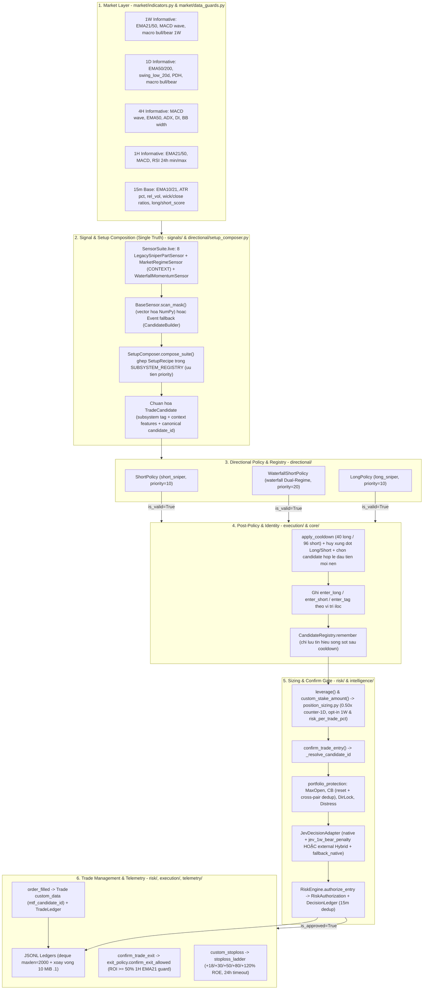

# MTF Sniper — Kiến Trúc Hệ Thống

**Package:** `strategies/mtf_sniper/` · **Version:** `STRATEGY_VERSION` trong `__init__.py` (`4.7.0-1w-regime`) · **Deploy:** Docker → `--strategy-path …/mtf_sniper`

**Bất biến cốt lõi:** Kiến trúc phân lớp chặt chẽ. Toàn bộ luật từ bản chiến lược cũ được đưa vào các tầng chuyên biệt; đường vào lệnh live luôn đi qua `EntryPipeline` (không bao giờ đánh tắt qua Policy ngay ở lớp chiến lược).

**Hồ sơ vận hành (Runtime profile):**
- **Local / Backtest (`deterministic`):** Dùng bộ chấm điểm tất định `JEV_MODE=native`, `enable_waterfall=true` (JevHunter đã gỡ hoàn toàn).
- **Docker Production (`decision_external`):** Dùng `JEV_MODE=external` Hybrid AI score (`w_ai=0.10`, `JEV_FAIL_POLICY=fallback_native`, timeout `4s`), `enable_waterfall=true`, `enable_dynamic_sizing=true`, `exchange_sync_interval_secs=15`. Xem thêm `STABILIZATION_DETERMINISTIC.md`.

**Tài liệu gốc chuẩn:** Đọc mục lục tại [`README.md`](./README.md) · File này + [`PHILOSOPHY.md`](./PHILOSOPHY.md) (triết lý chiến lược & lý do thiết kế) + [`DATA_CONTRACTS.md`](./DATA_CONTRACTS.md) (hợp đồng dữ liệu) + [`GUARDRAILS.md`](./GUARDRAILS.md) (ma trận DAG & 36 luật chống AI slop) mô tả đúng hành vi đang chạy thực tế. Ghi chú lịch sử nằm ở [`MIGRATION_PLAN.md`](./MIGRATION_PLAN.md).

---

## 0. Lớp Giao Tiếp (`StrategyMTFSniper`) vs Các Module Bên Trong

Freqtrade gọi trực tiếp vào `StrategyMTFSniper`; lớp này đóng vai trò facade mỏng điều phối sang các module:

| Hook Freqtrade | Vai trò chiến lược | Module xử lý |
|---|---|---|
| `bot_start` | Phân giải cấu hình 3 tầng (`EffectiveConfig`), kiểm tra `RuntimeMode` fail-fast & băm SHA-256 `fingerprint()` | `core/runtime_mode.py`, `core/config_resolve.py` |
| `bot_loop_start` | Tự làm mới vị thế live mỗi `15s` khi đang có lệnh mở (phát hiện đóng tay trên sàn) | `strategy_mtf_sniper.py` |
| `populate_indicators_*` | Tính chỉ báo đa khung (`1W`, `1D`, `4H`, `1H`, `15m`) | `market/indicators.py` |
| `populate_entry_trend` | Sinh tín hiệu vào lệnh + cooldown + ghi danh `CandidateRegistry` | `execution/entry_pipeline.py` |
| `leverage` / `custom_stake_amount` | Đòn bẩy (tối đa `10x`) + stake theo tag, ngược pha 1D (`0.50x`), 1W opt-in & trần `risk_per_trade_pct` | `risk/position_sizing.py` |
| `confirm_trade_entry` | Kiểm tra bảo vệ danh mục + JEV Decision + ghi `DecisionLedger` | `intelligence/` + `risk/` |
| `custom_stoploss` | Thang khoá lãi theo bậc ROE + cắt lỗ kẹt 24h | `risk/stoploss_ladder.py` |
| `confirm_trade_exit` | Hoãn chốt ROI `>= 50%` khi xu hướng 1H vẫn giữ | `execution/exit_policy.py` |
| `custom_exit` | Tắt (`use_exit_signal = False`) | `strategy_mtf_sniper.py` |
| `order_filled` | Lưu `mtf_candidate_id` vào Trade custom data + ghi `TradeLedger` | `core/candidate_*`, `telemetry/` |

**Nguyên tắc tín hiệu:**

1. **Sensors** chỉ phát hiện từng **sự kiện thành phần (part facts)** — tuyệt đối không ghi `enter_*`, không tính size, không gọi JEV.
2. Đủ bộ 4 phần chuẩn (ALL-4 parts) mới tạo thành một `TradeCandidate` gắn nhãn `setup:sniper_*`.
3. Khi `enable_waterfall=True`, `WaterfallMomentumSensor` (`waterfall_momentum`) phát hiện đà rơi theo `MomentumRadar` để `SetupComposer` gắn sub-system `waterfall` và chuyển thẳng qua `WaterfallShortPolicy` (lọc 2 chế độ Vacuum Breakdown / In-Range Collapse).
4. **Policy** quyết định **quyền hợp lệ (`is_valid`)** và gắn thêm **điểm chất lượng (`quality_grade`)**.
5. Thành phần rời rạc chưa đủ bộ $\neq$ mở lệnh.

---

## 1. Kiến Trúc Phân Lớp Toàn Luồng (End-to-End Flow)



| Chế độ ghép tín hiệu trong `SetupComposer.compose_suite()` | Khi nào dùng | Luồng thực thi chuẩn (Single Truth `LINT029`) |
|---|---|---|
| **Vectorized Mask Mode** | Mặc định khi mọi sensor trong `SensorSuite` hỗ trợ `scan_mask()` | `SensorSuite` → `scan_mask()` / `scan_mask_features()` → `SetupComposer._compose_from_masks()` → `DirectionalTradingEngine` |
| **Event Fallback Mode** | Tự động kích hoạt khi có bất kỳ sensor nào trả `scan_mask() is None` | `SensorSuite.scan()` → `CandidateBuilder` → `SetupComposer.compose()` → `DirectionalTradingEngine` |

**Thứ tự ưu tiên tất định khi nhiều Sub-System cùng khớp trên 1 cây nến (`SetupRecipe.priority`):**
- `SetupComposer` sắp xếp ứng viên theo `(candle_index, side, recipe.priority, recipe.name)`.
- Ở nhánh `short`, `short_sniper` (`priority=10`) luôn được đánh giá trước `waterfall` (`priority=20`). `EntryPipeline.run()` giữ ứng viên đầu tiên đạt `PolicyEvaluationResult.is_valid=True` tại mỗi `(side, candle_index)`; nếu `short_sniper` hợp lệ trên cùng cây nến, nhãn `short_A80_plus`/`short_B65_plus` được ưu tiên trước `waterfall_collapse` (nếu `short_sniper` bị từ chối thì `waterfall` vẫn được đánh giá bình thường).
- Hợp đồng đầu ra giữa Vectorized Mask Mode và Event Fallback Mode giống hệt nhau 100% (được khoá bằng `tests/strategy/test_mtf_candidate_parity.py`).

### Danh Mục Sub-Systems & Cảm Biến Ngữ Cảnh (`SUBSYSTEM_REGISTRY` & `SensorSuite.live`)

| Sub-System / Sensor | Chiều | Công thức & Độ ưu tiên | Tập cảm biến nguyên tử bắt buộc | Bộ đánh giá chuyên biệt & Nhãn vào lệnh |
|---|---|---|---|---|
| `long_sniper` | `LONG` | `setup:sniper_long` (`priority=10`) | `long_structure & long_mtf & long_macro & long_safety` | `LongPolicy` $\rightarrow$ `long_A80_plus` (`long_score >= 80`, cooldown `40` nến) |
| `short_sniper` | `SHORT` | `setup:sniper_short` (`priority=10`) | `short_structure & short_mtf & short_macro_floor & short_safety` | `ShortPolicy` $\rightarrow$ `short_A80_plus` \| `short_B65_plus` \| `short_C_sub65` (cooldown `96` nến) |
| `waterfall` | `SHORT` | `setup:waterfall_short` (`priority=20`) | `waterfall_momentum` (`MomentumRadar`, cooldown nội bộ `12` nến) | `WaterfallShortPolicy` $\rightarrow$ `waterfall_collapse` (2 chế độ Chân không / Trong biên) |
| `market_regime` | Phi hướng (`side=None`) | `SensorType.CONTEXT` | `market_regime_1w != "unknown"` | Đính kèm qua `_attach_suite_context()`; không tăng `confluence_count` và không tự mở lệnh |

---

## 2. Policy: Quyền Vào Lệnh (`is_valid`) vs Nhãn Chất Lượng (`quality_grade`)

| Trường | Ý nghĩa thực tế |
|---|---|
| `PolicyEvaluationResult.is_valid` | Điều kiện **đủ chuẩn vào lệnh** (cho phép đi tiếp tới cooldown / `enter_*`) |
| `quality_grade` | Nhãn đánh giá tham khảo — **không** loại các setup Sniper đã đủ 4 phần |
| Waterfall anomaly (`ShortPolicy`) | Kiểm tra 2 chế độ + bộ lọc chân không; khi `short_score > 0`, sàn điểm `base = max(0.70, short_score/100)` để tránh kèo Waterfall hợp lệ bị loại oan |
| Decision Gate | Đọc chuỗi 32 nến + điểm vĩ mô — **không** dùng `quality_grade` để xét duyệt |

---

## 3. Xác Nhận Lệnh, Tính Size, Rủi Ro & Vòng Đời Lệnh

```mermaid
flowchart LR
  pop["populate_entry_trend"] -->|"enter_* + registry"| size["leverage / custom_stake_amount"]
  size -->|"amount, rate"| conf["confirm_trade_entry"]
  conf -->|"guards + JEV + equity"| auth["RiskEngine.authorize_entry"]
  auth -->|"is_approved"| fillIn["order_filled (entry)"]
  fillIn -->|"luu mtf_candidate_id"| hold["Vi The Dang Mo"]
  hold -->|"moi loop / nen"| sl["custom_stoploss (ladder)"]
  hold -->|"kiem tra ROI"| ex["confirm_trade_exit"]
  sl --> fillOut["order_filled (exit)"]
  ex --> fillOut
  fillOut -->|"MFE/MAE + PnL"| tlog["TradeLedger"]
```



**`RiskEngine`** phục vụ hai điểm nối khác nhau của Freqtrade (xem thêm `DATA_CONTRACTS.md` §3.5):

| Bề mặt | Việc nó làm | Việc nó **không** làm |
|---|---|---|
| `confirm_trade_entry` → `authorize_entry` → `RiskAuthorization` | Kiểm tra bảo vệ danh mục + JEV Decision; ghi log `est_stake`, `wallet_equity`, `ai_confidence`, `market_regime`, `policy_score`; trả **`is_approved`** | Không trực tiếp thay đổi khối lượng hoặc đòn bẩy của lệnh đặt |
| `leverage()` / `custom_stake_amount()` | Trả giá trị Freqtrade áp dụng thật vào lệnh (`get_leverage` / `get_stake_amount`) | Không tính size theo khoảng cách Stoploss (ATR/SL distance sizing) |
| `custom_stoploss()` | Điều chỉnh SL theo thang ROE (`+18/+30/+50/+80/+120%`) & cắt sau 24h âm | Không đặt SL cứng trên sàn ngoài callback Freqtrade |

**Phân tầng cấu hình (`config_resolve.py`):**
- Mặc định Python: `enable_dynamic_sizing=False` (`1.0x`), `risk_per_trade_pct=None`, `counter_1w_stake_scale=1.0`, `jev_1w_bear_penalty=0.0`.
- Khi bật `enable_dynamic_sizing=true` (trong `user_data/config.json` & `docker/config.mtf_sniper.json`): áp dụng `tag_multipliers` (`_TAG_MULTIPLIERS`) $\times$ `resolve_counter_1d_scale(..., counter_1d_stake_scale)` (`0.50x`) $\times$ `resolve_counter_1w_scale(..., counter_1w_stake_scale)`, chặn trên bởi `max_stake` và trần rủi ro SL theo vốn ví `resolve_risk_cap_stake` nếu `risk_per_trade_pct` được cấu hình (`> 0`). Trên Docker production (`docker/config.mtf_sniper.json`), `jev_1w_bear_penalty=0.35` giúp siết chặt Long ngược sóng giảm khung Tuần (`1W`).
- Các tham số vào/lọc/sizing và runtime đều được chụp thành `EffectiveConfig` và băm ra `fingerprint()` khi khởi động.

### Ma Trận Chế Độ Vận Hành (`RuntimeMode`) & Công Thức Cổng JEV Decision

| `mtf_runtime_mode` | Cổng JEV Decision | Kết nối API ngoài | Cơ chế chấm điểm & Lưu đệm |
|---|---|---|---|
| `pure_deterministic` | Buộc **TẮT** | Khoá cứng (`force_native=True`) | Cô lập thuần tuý bộ luật kỹ thuật Sniper + Waterfall + Quản trị danh mục |
| `deterministic` | Tuỳ chọn `native` | Khoá cứng (`force_native=True`) | Mặc định cho Backtest: chạy `_evaluate_native_sequence()` `<1ms` trong RAM (`>= 0.70` duyệt), bỏ qua I/O SQLite |
| `decision_native` | Tuỳ chọn `native` | Khoá cứng (`force_native=True`) | Chạy tường minh bộ chấm điểm nội tại kèm mức phạt `jev_1w_bear_penalty` |
| `decision_external` | Điểm lai `Hybrid` | Typesafe `jev-latest` (timeout `4s`) | Mặc định Docker: `hybrid = native_conf + w_ai * (noul - 0.5) * 2 - choppy_penalty` (`w_ai=0.10`, `choppy_penalty=0.05`, ngưỡng `0.70`, `fallback_native`, lưu đệm SQLite WAL tách biệt theo token ngưỡng) |

---

## 4. Vòng Đời `candidate_id`

```text
populate → lọc cooldown / xung đột → CandidateRegistry.remember (chỉ giữ nến sống sót)
confirm / order_filled → tìm trong registry (tối đa 6h)
                      → nếu thiếu: tái tạo từ enter_* gần nhất (tối đa 6h)
                      → nếu vẫn không có: gắn candidate_id_missing
khớp vào lệnh → lưu Trade.set_custom_data(mtf_candidate_id) + giữ map RAM
khớp thoát lệnh → ưu tiên đọc custom_data → ghi TradeLedger (deque + xoay vòng 10 MiB)
```

Tuyệt đối không tự chế ID giả sai định dạng. ID đọc từ DB phải khớp đúng cặp tiền và chiều (`pair` / `side`) của lệnh.

---

## 5. Bản Đồ Module

| Tầng | Vai trò | Đường dẫn |
|---|---|---|
| Triết lý | Bản chất edge, phễu 4 khung, lý do thiết kế từng lớp | `docs/PHILOSOPHY.md` |
| Market | Chỉ báo đa khung (`1W`/`1D`/`4H`/`1H`/`15m`), safety masks & data readiness guards | `market/indicators.py`, `market/data_guards.py` |
| Sensors | Part masks chuẩn + concrete sensors (`MarketRegimeSensor`, `WaterfallMomentumSensor`, `LegacySniperPartSensor`) | `signals/sniper_part_masks.py`, `signals/sensor_suite.py`, `signals/sensors/` |
| Builder | Gom / khử xung đột cho sensor sự kiện thuần (`scan_mask() is None`) | `signals/candidate_builder.py` |
| Composer | Single-Truth recipe matcher (`compose_suite` mask + event fallback) | `directional/setup_composer.py`, `setup_recipes.py` |
| Policy | Hợp lệ `short_sniper` / `long_sniper` + tách riêng `WaterfallShortPolicy` | `directional/*/policy.py`, `directional/short/waterfall_policy.py` |
| Entry | Điều phối `SetupComposer.compose_suite` → cooldown + registry (`LINT029`) | `execution/entry_pipeline.py` |
| Decision | Native / External Hybrid (`fail_policy` đồng bộ) | `intelligence/decision_adapter.py`, `jev_decision.py` |
| Risk | Guards (CB/DirLock/Distress), sizing `0.50x`, thang SL | `risk/portfolio_protection.py`, `position_sizing.py`, `stoploss_ladder.py`, `risk_engine.py` |
| Exit | Hoãn chốt ROI khi giữ trend 1H (`confirm_exit_allowed`) | `execution/exit_policy.py` |
| Telemetry | Sổ nhật ký JSONL giới hạn RAM + xoay file 10 MiB | `telemetry/decision_ledger.py`, `trade_ledger.py`, `jsonl_io.py` |
| Sync | Tự làm mới ví/vị thế live mỗi `15s` (`bot_loop_start`) | `strategy_mtf_sniper.py` (`exchange_sync_interval_secs`) |
| Identity | Canonical ID + registry bền vững qua restart | `core/candidate_id.py`, `candidate_registry.py` |
| Config | RuntimeMode fail-fast + chuẩn hoá 3 tầng + fingerprint | `core/runtime_mode.py`, `config_resolve.py` |

---

## 6. Nguyên Tắc Bất Di Bất Dịch & Ràng Buộc Kiến Trúc Bằng Code

### 6.1 Ràng buộc tự động 5 lớp (`GUARDRAILS.md`)
Toàn bộ kiến trúc 8 tầng được khoá cứng bằng code thông qua gói `scripts/guardrails/` (`ArchitectureManifest` + `LINT001`–`LINT036` + Pyrefly + Ruff) và thực thi tự động qua 5 vòng: Manifest $\rightarrow$ Cursor `postToolUse` Hook `<150ms` (`.cursor/hooks/post-edit-guardrails.sh`) $\rightarrow$ Cursor Rule $\rightarrow$ Git `pre-commit` $\rightarrow$ `docker/Dockerfile.custom`.

Xem bảng **Ma trận Allowlist DAG 8 tầng** và **danh mục đầy đủ 36 quy tắc `LINT001`–`LINT036`** tại [`GUARDRAILS.md`](./GUARDRAILS.md).

```bash
# Kiểm tra toàn bộ ranh giới tầng + chống AI slop + liệt kê registry sub-system + chạy pytest:
.venv/bin/python scripts/lint_guardrails.py --verify-all
```

### 6.2 Quy trình chuẩn khi bổ sung 1 Sub-System mới (Plug-and-Play)
1. **Tạo Sensor đơn lẻ (`signals/sensors/`):** kế thừa `BaseSensor`, bắn `TriggerEvent` cho tín hiệu nguyên tử (tuyệt đối không viết rule portfolio hay `enter_*`).
2. **Tối ưu tốc độ Backtest / Hyperopt (khuyến nghị):** cài đặt thêm `scan_mask()` + `scan_mask_features()` bằng NumPy ngay trên Sensor đó để `SetupComposer.compose_suite()` cắt bằng mask ở tầng C thay vì cấp phát `TriggerEvent`.
3. **Đăng ký Recipe & Spec (`directional/setup_recipes.py`):** thêm `SetupRecipe` (tập `required_sensors`, `side`, `subsystem`, `priority`) và `SubSystemSpec` vào `SUBSYSTEM_REGISTRY`.
4. **Cài bộ lọc/đánh giá (`directional/<side>/`):** triển khai hoặc mở rộng evaluator tuân theo `DirectionalPolicyProtocol` → trả về `PolicyEvaluationResult`.
5. **Chạy cổng kiểm tra:** `.venv/bin/python scripts/lint_guardrails.py --verify-all`.

### 6.3 Checklist không được làm hỏng
- Mọi tín hiệu sống bắt buộc đi qua **một đường Single Truth duy nhất** (`SensorSuite` → `SetupComposer.compose_suite` → `DirectionalTradingEngine`); mọi tối ưu vector hoá giữ parity xanh (`tests/strategy/test_mtf_sniper_mask_parity.py`, `test_mtf_candidate_parity.py`).
- Thành phần rời rạc $\neq$ mở lệnh (`enter_*`).
- `CandidateRegistry.remember` chỉ lưu các ứng viên đã sống sót qua `apply_cooldown` và khử xung đột Long/Short.
- Circuit Breaker phải reset chuỗi thua sau khi kích hoạt nghỉ 72h và gộp trùng các lệnh BTC+ETH thua cùng sóng.
- Giữ Hunter tắt khỏi pipeline live trừ khi có dự án đánh giá lại riêng.
- Mọi hợp đồng trong `DATA_CONTRACTS.md` phải khớp với `core/contracts.py`.
