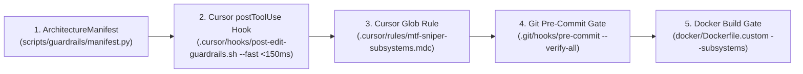

# MTF Sniper — Kiến Trúc Guardrails 5 Lớp & Quy Tắc Chống AI Slop

**Package:** `strategies/mtf_sniper/` · **Engine kiểm tra:** `scripts/guardrails/` & `scripts/lint_guardrails.py`  
**Version:** khớp `STRATEGY_VERSION` trong `__init__.py` (`4.7.0-1w-regime`)

Tài liệu này mô tả hệ thống **Architecture-as-Code Guardrails** được thiết kế để khoá cứng kiến trúc 8 tầng của MTF Sniper ngay từ phía mã nguồn, ngăn chặn triệt để tình trạng AI Agent viết code rác (AI slop), phá ranh giới phân lớp, tạo file nhân bản hoặc bỏ sót tài liệu.

---

## 1. Năm Vòng Bảo Vệ Tự Động (Defense-in-Depth)



1. **Vòng 1 — Khai báo Kiến trúc bằng Code (`scripts/guardrails/manifest.py`):** Đóng băng `ArchitectureManifest` (`frozen=True`) làm nguồn sự thật duy nhất cho danh sách thư mục hợp lệ, file gốc hợp lệ, ma trận import DAG 8 tầng, ngân sách dòng code và danh mục tài liệu chuẩn.
2. **Vòng 2 — Phản hồi Tức thời trong Lúc Agent Sửa File (`.cursor/hooks/post-edit-guardrails.sh`):** Đăng ký tại `.cursor/hooks.json` ở sự kiện `postToolUse` (`Write|StrReplace|Delete`). Ngay khi Agent chạm vào `strategies/mtf_sniper/**` hoặc `scripts/guardrails/**`, hook chạy `--fast` trong `<150ms` và bơm thẳng thông báo `[MTF SNIPER ARCHITECTURE GUARDRAIL VIOLATION]` vào ngữ cảnh để buộc Agent sửa ngay lập tức trước khi viết tiếp.
3. **Vòng 3 — Định hướng Ngữ cảnh Sớm (`.cursor/rules/mtf-sniper-subsystems.mdc`):** Tự động nạp quy ước DAG và chống AI slop ngay khi Agent đọc/mở file thuộc chiến lược hoặc bộ test.
4. **Vòng 4 — Cổng Chặn Git Pre-Commit (`.git/hooks/pre-commit`):** Thực thi `--verify-all` (toàn bộ `LINT001`–`LINT036` + Pyrefly + Ruff + toàn bộ `pytest tests/strategy/`).
5. **Vòng 5 — Cổng Chặn Build Production (`docker/Dockerfile.custom`):** Sao chép `scripts/lint_guardrails.py` + `scripts/guardrails/` vào `/tmp/scripts` và chạy kiểm định ngay trong lúc build Docker image — đảm bảo không một bản build sai kiến trúc nào có thể lọt lên Raspberry Pi.

---

## 2. Tổ Chức Các Module Trong `scripts/guardrails/`

| Tệp mã nguồn | Trách nhiệm chính |
|---|---|
| `scripts/guardrails/manifest.py` | Định nghĩa `ArchitectureManifest` và hằng chuẩn `DEFAULT_MANIFEST` |
| `scripts/guardrails/layer_rules.py` | Giải cả import tuyệt đối, import tương đối (`from ..`) lẫn lazy import nằm sâu trong thân hàm; kiểm tra Ma trận DAG (`LINT030`) và các luật cô lập tầng (`LINT003`, `LINT004`, `LINT007`–`LINT009`, `LINT017`, `LINT020`, `LINT023`) |
| `scripts/guardrails/anti_slop_rules.py` | Kiểm tra cấu trúc thư mục/tên file (`LINT031`), chống `TODO`/stub rỗng (`LINT032`), chống `# type: ignore`/`# noqa` trần & `eval`/`exec` (`LINT033`), chống `print()` & lặp dòng DataFrame (`LINT034`), ngân sách kích thước & default khả biến (`LINT035`), và đối chiếu Docs $\leftrightarrow$ Code (`LINT036`) |
| `scripts/guardrails/registry_rules.py` | Nạp runtime `SUBSYSTEM_REGISTRY`, đối chiếu `SetupRecipe`, tính duy nhất của `priority` cùng chiều, `DirectionalPolicyProtocol`, bảng điều phối `subsystem_policies` và độ phủ `SensorSuite` (`LINT024`–`LINT028`) |
| `scripts/lint_guardrails.py` | CLI điều phối tổng hợp (`--fast`, `--subsystems`, `--strict`, `--verify-all`), kết nối thêm Pyrefly (`LINT015`), Ruff (`LINT019`) và `pytest` |

---

## 3. Ma Trận Allowlist DAG 8 Tầng (`LINT030` — `0` Ngoại Lệ)

Mọi lệnh `import` nội bộ trong `strategies/mtf_sniper/` (kể cả import tương đối và lazy import trong hàm) chỉ được phép trỏ tới tập đích trong bảng Allowlist dưới đây (`__root__` là metadata gốc `strategies.mtf_sniper` chứa `STRATEGY_VERSION`):

| Tầng nguồn (`source_layer`) | Tập tầng đích nội bộ được phép import (`allowed_targets`) | Ý nghĩa kiến trúc |
|---|---|---|
| `__init__.py` | *(Rỗng — không import nội bộ)* | Gốc metadata phiên bản tinh gọn, tránh vòng lặp import khi nạp gói |
| `core/` | `{__root__, core}` | Tầng 0 độc lập tuyệt đối: hợp đồng `frozen=True`, Enums, `candidate_id`, cấu hình |
| `market/` | `{market}` | Tầng 1 thuần túy phi trạng thái: chỉ báo 5 khung & kiểm tra dữ liệu hữu hạn |
| `signals/` | `{core, market, signals}` | Tầng 2 cảm biến nguyên tử & part masks: **cấm tuyệt đối chạm `directional/`** |
| `directional/` | `{core, market, signals, directional}` | Tầng 3 ghép công thức & Policy (kèm luật `LINT003` cấm chéo `long` $\leftrightarrow$ `short`) |
| `telemetry/` | `{core, telemetry}` | Sổ nhật ký JSONL độc lập, không phụ thuộc ngược vào Risk hay Execution |
| `risk/` | `{core, risk}` | Toán học quản trị danh mục, định cỡ vốn và thang SL cô lập sạch |
| `intelligence/` | `{__root__, core, directional, intelligence}` | Cổng JEV Decision đọc cấu hình setup nhưng cấm chạm Execution / Risk / Telemetry |
| `execution/` | `{core, market, signals, directional, execution}` | Điều phối `EntryPipeline` (Single-Truth) & `exit_policy`, tách rời Risk / AI |
| `strategy_mtf_sniper.py` (`facade`) | `{__root__, core, market, execution, intelligence, risk, telemetry}` | **Cấm Facade import thẳng `signals` hay `directional`** — bắt buộc đi qua `execution/entry_pipeline.py` |

---

## 4. Danh Mục Đầy Đủ 36 Quy Tắc Kiểm Soát (`LINT001`–`LINT036`)

### Nhóm A — Kỷ Luật Code, Ngôn Ngữ & An Toàn Dữ Liệu (`LINT001`–`LINT019`)

| Mã quy tắc | Phạm vi | Ràng buộc bất biến được thực thi |
|---|---|---|
| `LINT001` | Toàn bộ `.py` | Cấm các chú thích né tránh xử lý tận gốc (`workaround`, `hack`, `fixme`, `quickfix`, `bypass_rule`) |
| `LINT002` | File `> 50` dòng | Mật độ dòng chú thích `#` bắt buộc `<= 5.0%` (ép viết code tự giải thích qua tên hàm/biến rõ nghĩa) |
| `LINT003` | `directional/{long,short}/` | Cô lập tuyệt đối hai nhánh chiến lược: `long` cấm import `short` và ngược lại |
| `LINT004` | `signals/sensors/` | Concrete sensor cấm import ngược lên `execution` hoặc `strategy_mtf_sniper` |
| `LINT005` | AST toàn gói | Cấm ghi đè trực tiếp `os.environ["JEV_MODE"]` lúc chạy (phải truyền qua `RuntimeMode` / tham số tường minh) |
| `LINT006` | AST toàn gói | Cấm dùng các mã model `jev-hunter-*` tự chế; chỉ chấp nhận bí danh chuẩn `jev-latest` |
| `LINT007` | `core/` | Tầng `core/` cấm import bất kỳ tầng nào cao hơn (`market`, `signals`, `directional`, `execution`, `risk`, `intelligence`, `telemetry`) |
| `LINT008` | `market/` | Tầng `market/` cấm import ngược lên các tầng tín hiệu, chính sách, thực thi hoặc rủi ro |
| `LINT009` | Mọi module nội bộ | Cấm các phân hệ con import ngược lại Facade `strategy_mtf_sniper.py` (chống phụ thuộc vòng) |
| `LINT010` | AST toàn gói | Cấm tuyệt đối `.shift(-k)` nhìn trước dữ liệu tương lai (anti-lookahead bias) |
| `LINT011` | AST toàn gói | Cấm nuốt lỗi im lặng `except: pass` hoặc `except Exception: pass` |
| `LINT012` | Toàn bộ `.py` | Bắt buộc 100% tiếng Anh trong code và comment Python (tài liệu tiếng Việt đặt riêng trong `docs/`) |
| `LINT013` | `execution/entry_pipeline.py` | Cấm gán dữ liệu qua nhãn `.loc[...]` (chống lỗi nhân bản tín hiệu khi trùng index label; phải dùng mảng NumPy / `.iloc`) |
| `LINT014` | AST thân hàm | Cấm ép kiểu dư thừa (`float(x)` khi `x: float`, `bool(a > b)`, `str("abc")`) |
| `LINT015` | Pyrefly Static Check | Kiểm tra kiểu tĩnh nghiêm ngặt bằng Meta Pyrefly trên toàn bộ `strategies/mtf_sniper/` và `scripts/guardrails/` |
| `LINT016` | `core/contracts.py` | Mọi `@dataclass` hợp đồng dữ liệu liên tầng bắt buộc khai báo `frozen=True` |
| `LINT017` | `strategy_mtf_sniper.py` | Cấm Facade import trực tiếp thư viện chỉ báo (`talib`, `technical`); phải uỷ quyền về `market/indicators.py` |
| `LINT018` | `signals/sensors/` | Mọi class kết thúc bằng `*Sensor` bắt buộc kế thừa trực tiếp từ `BaseSensor` |
| `LINT019` | Ruff Check | Kiểm tra chuẩn hiện đại hoá Python, độ phức tạp hàm McCabe `<= 12` (`C901`), độ dài dòng `<= 100` (`E501`) và import sort |

### Nhóm B — Khoá Kiến Trúc Sub-System & Luồng Single-Truth (`LINT020`–`LINT029`)

| Mã quy tắc | Phạm vi | Ràng buộc bất biến được thực thi |
|---|---|---|
| `LINT020` | `signals/` | Tầng `signals/` cấm tuyệt đối import từ `directional`, `execution`, `risk`, `intelligence`, `telemetry`, `strategy_mtf_sniper` |
| `LINT021` | `signals/sensors/` | Sensor không bao giờ được đọc/ghi tên cột giao dịch của Freqtrade (`enter_long`, `enter_short`, `exit_long`, `exit_short`) |
| `LINT022` | `directional/setup_composer.py` | Cấm bóp nghẹt đa sub-system bằng map 1-1 theo chiều (`_by_side` / `{r.side: r}`); phải dùng `recipes_grouped_by_side` |
| `LINT023` | `directional/` | Tầng `directional/` cấm import `execution`, `risk`, `intelligence`, `telemetry`, `strategy_mtf_sniper` |
| `LINT024` | `SUBSYSTEM_REGISTRY` | Kiểm tra hợp lệ `all_live_recipes()`, khớp 1-1 với `SUBSYSTEM_REGISTRY`, và **cấm trùng `SetupRecipe.priority` trên cùng một chiều** |
| `LINT025` | `SUBSYSTEM_REGISTRY` | **1 Sub-System = 1 class Policy riêng biệt**; tự động nạp động và kiểm tra `isinstance(policy, DirectionalPolicyProtocol)` |
| `LINT026` | `engine.py` & `entry_pipeline.py` | Bắt buộc `DirectionalTradingEngine` điều phối qua `subsystem_policies` và `EntryPipeline` gọi `SetupComposer.compose_suite()` |
| `LINT027` | `execution/entry_pipeline.py` | Cấm gắn nhãn `"subsystem"` không tồn tại trong `SUBSYSTEM_REGISTRY` |
| `LINT028` | `SensorSuite` | Mọi `sensor_name` trong `SetupRecipe.required_sensors` bắt buộc tồn tại thật trên `SensorSuite.live()` / `SensorSuite.full()` |
| `LINT029` | `execution/entry_pipeline.py` | Khóa Single-Truth: cấm tái lập Fast Path (`_candidates_from_sniper_masks`, `MomentumRadar`, `cached_sniper_parts`) hoặc gọi thẳng `TradeCandidate()` trong `execution/` |

### Nhóm C — Ma Trận DAG Toàn Cục & Chống AI Slop (`LINT030`–`LINT036`)

| Mã quy tắc | Phạm vi | Ràng buộc chống code rác AI được thực thi |
|---|---|---|
| `LINT030` | Toàn bộ 8 tầng | Kiểm tra mọi lệnh import tuyệt đối, tương đối và lazy import đối chiếu nghiêm ngặt với `ArchitectureManifest.layer_allowed_imports` |
| `LINT031` | Cây thư mục gói | Chặn thư mục lạ (`utils/`, `helpers/`, `common/`, `v2/`, `tmp/`...), file nhân bản/rác (`*_v2.py`, `*_new.py`, `*_old.py`, `*_tmp.py`, `*helper*.py`, `*util*.py`), file `.md` ngoài `docs/`, và file lạ ở gốc gói |
| `LINT032` | Toàn bộ `.py` | Cấm chú thích bỏ dở (`TODO`, `TBD`, `XXX`, `PLACEHOLDER`, `COMING SOON`) và cấm hàm/method rỗng (`pass`, `...`, `raise NotImplementedError`) ngoài `ABC`/`@abstractmethod` và `Protocol` |
| `LINT033` | Toàn bộ `.py` | Cấm bịt miệng linter mù quáng (`# type: ignore` không ghi `[error-code]`, `# noqa` không ghi `: RULE_ID`) và cấm `eval()` / `exec()` |
| `LINT034` | Toàn bộ `.py` | Cấm `print()` trong code chiến lược (phải dùng `logger.*`) và cấm lặp dòng DataFrame chậm (`.iterrows()`, `.itertuples()`, `.apply(..., axis=1)`) |
| `LINT035` | Toàn bộ `.py` | Khoá ngân sách chống phình God-Object: module phân hệ con `<= 550` dòng (`strategy_mtf_sniper.py <= 1250`, `jev_decision.py <= 1500`), hàm `<= 165` dòng, và cấm default argument khả biến (`=[]`, `={}`) |
| `LINT036` | `docs/*.md` $\leftrightarrow$ Code | Tự động đối chiếu bộ tài liệu chuẩn (`README.md`, `PHILOSOPHY.md`, `ARCHITECTURE.md`, `DATA_CONTRACTS.md`, `GUARDRAILS.md`) với `STRATEGY_VERSION`, đầy đủ các giá trị `SensorType`, các mã `LINT001`–`LINT036`, và cấm sót tên class cũ đã xoá (`HunterEscalationGateway`, `JevEntryHunter`) |

---

## 5. Phân Định Phạm Vi: Guardrails Tĩnh/Runtime vs Bộ Test Nghiệp Vụ (`411+` Tests)

- **Tầng Guardrails (`LINT001`–`LINT036`):** Khoá cứng **hình thái kiến trúc, chiều phụ thuộc DAG, giao diện Protocol, cấu trúc thư mục, hiệu năng vector hoá cơ bản, kỷ luật kiểu dữ liệu và đồng bộ tài liệu**. Chạy cực nhanh (`<150ms` ở chế độ `--fast`) ngay sau mỗi thao tác sửa code của Agent.
- **Tầng Kiểm thử Nghiệp vụ (`pytest tests/strategy/`, tích hợp trong `--verify-all`):** Khoá cứng **toàn bộ toán học và ngữ nghĩa giao dịch** bên trong từng phân hệ — bao gồm tính tương đương 100% giữa `scan_mask()` và `scan()`, bậc thang khoá lãi 5 nấc ROE, cửa sổ nghỉ 72h & gộp trùng sóng BTC+ETH của Circuit Breaker, hạ vốn `0.50x` ngược pha 1D, trần rủi ro `risk_per_trade_pct`, và tính bền vững `mtf_candidate_id` qua restart.

---

## 6. Chế Độ Chạy CLI

```bash
# 1. Chế độ tức thời (<150ms, dùng trong Cursor postToolUse hook):
.venv/bin/python scripts/lint_guardrails.py --fast

# 2. Liệt kê bảng SUBSYSTEM_REGISTRY kèm kiểm tra đầy đủ LINT001-LINT036 + Pyrefly + Ruff:
.venv/bin/python scripts/lint_guardrails.py --subsystems --strict

# 3. Cổng kiểm định toàn diện (bắt buộc trước khi hoàn tất task hoặc git commit):
.venv/bin/python scripts/lint_guardrails.py --verify-all
```
