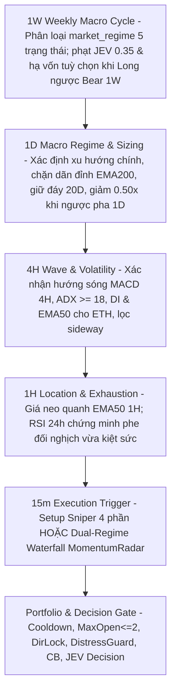

# MTF Sniper — Triết Lý Chiến Lược & Nguồn Gốc Thiết Kế

**Package:** `strategies/mtf_sniper/` · **Version:** `4.7.0-1w-regime`  
**Cặp giao dịch:** `BTC/USDT:USDT`, `ETH/USDT:USDT` (Futures Isolated 10x)  
**Trục đa khung thời gian:** `1W` (Chu kỳ vĩ mô) → `1D` (Xu hướng chính) → `4H` (Sóng & Biến động) → `1H` (Vị thế & Kiệt sức) → `15m` (Điểm bóp cò)

---

## 1. Bản Chất Lợi Thế (Core Edge): Convex Asymmetric Trend-Following Breakout

**MTF Sniper** ngay từ đầu được định hình để **từ bỏ lối đánh scalping ăn đều hằng ngày**, tập trung hoàn toàn vào việc **bắt phần đuôi lệch phải (convex payoff)** của các con sóng lớn trên BTC và ETH Futures:

- **Tỷ lệ thắng thực tế (~55%):** Đa số các lệnh bình thường sẽ thoát quanh hòa vốn hoặc cắt lỗ gọn khi kịch bản gãy. Phần lớn lợi nhuận ròng đến từ **số ít lệnh bắt trọn nhịp bùng nổ kéo dài nhiều giờ tới nhiều ngày (`+50%` đến `+120%+ ROE` ở đòn bẩy 10x)**.
- **Khung nhỏ không bao giờ đứng một mình (*Regime != Trigger*):** Một cây nến breakout 15m đẹp gần như vô nghĩa nếu đâm vào tường kháng cự khung lớn, thị trường sideway nhiễu loạn, hoặc đi ngược xu hướng chính. Mọi tín hiệu đều phải vượt qua **phễu lọc 4 khung từ trên xuống dưới** trước khi được phép đặt lệnh.
- **Thoát lệnh chống bóp sóng (`use_exit_signal = False`):** Thực nghiệm cho thấy các tín hiệu thoát sớm theo chỉ báo 15m thường cắt non ngay giữa nhịp chạy và phá hủy toàn bộ phần lãi đuôi. Vì vậy quyền đóng lệnh được giao hoàn toàn cho thang nâng cắt lỗ một chiều (`risk/stoploss_ladder.py`), cơ chế hoãn chốt ROI giữ trend trên khung 1H (`execution/exit_policy.py`), và các giới hạn bảo vệ an toàn.

---

## 2. Cách Hệ Thống Được Định Hình: Phễu Lọc 5 Khung (`1W -> 1D -> 4H -> 1H -> 15m`)

Hệ thống lọc nhiễu từ trên xuống qua 5 khung thời gian để điểm vào 15m chỉ nổ súng tại đúng vùng mất cân bằng có tỷ lệ Lợi nhuận / Rủi ro lệch hẳn về phía mình:

### Tầng 0 — Khung `1W`: Chu Kỳ Vĩ Mô Tuần & Cảm Biến Ngữ Cảnh Phi Hướng (`v4.7.0-1w-regime`)
- **Lý do tồn tại:** Một nhịp hồi trên khung Ngày (`1D`) nằm giữa chu kỳ phân phối đỉnh hoặc downtrend khung Tuần (`1W`) thường có xác suất thất bại cao hơn hẳn so với nhịp thuận chu kỳ lớn. Tuy nhiên, nếu chặn cứng (hard-block) toàn bộ lệnh Long trên khung Tuần thì sẽ bỏ lỡ các sóng hồi lớn đầu chu kỳ mới.
- **Cơ chế phân loại & làm giàu ngữ cảnh:**
  - `populate_indicators_1w` (`market/indicators.py`) tính toán EMA21/50, sóng MACD, RSI, ADX, BB width khung Tuần và phân loại cột `market_regime` thành 5 trạng thái: `bull_trending`, `chop`, `bear_relief`, `cycle_top`, và `bear_trending`.
  - `MarketRegimeSensor` (`signals/sensors/market_regime.py`) hoạt động với vai trò **`SensorType.CONTEXT` (`side=None`)**: chỉ đính kèm đặc trưng chu kỳ Tuần (`regime_1w`, `is_bear_wave_1w`, `macdhist_1w`, `adx_1w`, `rsi_1w`) vào `TradeCandidate.raw_features` qua `_attach_suite_context()`, **không tự kích hoạt ứng viên độc lập và không làm tăng `confluence_count`**.
  - **Điều tiết mềm tại Cổng JEV & Định cỡ:** Khi lệnh Long đi ngược sóng giảm khung Tuần (`cycle_top` / `bear_trending`), cổng JEV trừ mức phạt cấu hình `jev_1w_bear_penalty` (bật ở mức **`0.35`** trên Docker production, giúp nâng Profit Factor 7 năm Fixed-100 lên `1.84` và cải thiện đồng loạt cả 3 cửa sổ walk-forward), đồng thời hỗ trợ hạ khối lượng qua tham số tuỳ chọn `counter_1w_stake_scale`.

### Tầng 1 — Khung `1D`: Xác Định Chế Độ Vĩ Mô & Phân Bổ Vốn Bất Đối Xứng
- **Lý do tồn tại:** Trên crypto, xu hướng khung Ngày tạo quán tính rất mạnh. Bắt đáy trong downtrend ngày hoặc Short húc đầu vào siêu sóng tăng (`is_macro_bull_run_1d == 1.0`) rất dễ dính chuỗi SL đầy đủ.
- **Bộ lọc gốc của nhánh Sniper:**
  - **LONG (`long/setups.py`):** Buộc giá nằm trên `ema_50_1d` và `ema_200_1d`, `is_macro_bear_market_1d == 0`, và khoảng cách tới EMA200 ngày không vượt quá `53%` (`dist_from_ema_200_1d <= 0.53`) để tránh fomo đu đỉnh cuối chu kỳ.
  - **SHORT (`short/setups.py`):** Cấm Short trong Macro Bull Run 1D, tránh bán ngay vùng quá bán hoảng loạn (`is_deep_capitulation_1d == 0`), và với Sniper chuẩn thì buộc phải còn dư địa phía trên đáy 20 ngày (`floor_dist >= 3.5%`).
- **Giảm size ngược pha 1D (`v4.6.0-counter1d`):** Khi cấu hình `long_block_1d_macd=false` vẫn cho phép đánh các nhịp LONG hồi kỹ thuật trong pha 1D yếu, hàm `resolve_counter_1d_scale` trong `risk/position_sizing.py` tự động hạ khối lượng xuống **`0.50x`** (`counter_1d_stake_scale`, có thể tối ưu qua Hyperopt). Nhờ vậy:
  - Kèo hồi ngắn vẫn tham gia ăn sóng được khi 15m/1H/4H đồng thuận.
  - Nếu xu hướng lớn 1D gãy tiếp (như cú bull-trap `2026-11-04`), thiệt hại bị cắt hơn một nửa (Max Drawdown 5 năm giảm từ `19.20%` xuống **`14.42%`**).
  - Tương tự, SHORT chỉ bị giảm `0.50x` khi `is_macro_bull_run_1d == 1.0`, còn các cú Short gãy đỉnh / Waterfall vẫn giữ nguyên `1.0x`.

### Tầng 2 — Khung `4H`: Đồng Thuận Sóng & Tránh Chop
- **Lý do tồn tại:** Dù 1D đang thuận, việc vào lệnh ngược một con sóng hồi trên khung 4H vẫn khiến lệnh bị quét dừng lỗ trước khi kịp chạy đúng hướng.
- **Cơ chế:** Bắt buộc `min_adx_4h >= 18.0`, đồng thuận sóng (`macdhist_4h > 0` cho Long; `is_bull_wave_4h == 0` cho Short, cộng thêm `minus_di_4h > plus_di_4h` riêng cho ETH), và bộ lọc biến động / sideway để bỏ qua các đoạn thị trường tắt thanh khoản.

### Tầng 3 — Khung `1H`: Điểm Tựa Cấu Trúc & Phe Đối Nghịch Kiệt Sức
- **Lý do tồn tại:** Thay vì đuổi theo khi giá đã chạy xa vùng cân bằng, chiến lược chờ **phe đối nghịch vừa bị rũ/kiệt sức** ngay tại vùng `ema_50_1h`:
  - **LONG:** Phe bán vừa xả cạn lực trong 24h (`rsi_min_24_1h <= 57.1`), giá giành lại vùng quanh `ema_50_1h` (`close_1h >= ema_50_1h * 0.988`).
  - **SHORT:** Phe mua vừa hưng phấn kiệt sức trong 24h (`rsi_max_24_1h >= 55.1`), MACD 1H quay đầu, và giá nằm đúng vùng đẹp quanh `ema_50_1h` (`[0.991x, 1.025x]`) thay vì Short đuổi lúc giá đã rơi quá sâu bên dưới EMA50 1H.

### Tầng 4 — Khung `15m`: Hai Cửa Kích Hoạt Lệnh
1. **Complete Sniper 4-Part Setup (`setup:sniper_long` / `setup:sniper_short`):**
   - Yêu cầu đủ cả 4 nhóm điều kiện (`*_structure`, `*_mtf`, `*_macro*`, `*_safety`): nến breakout thân đặc (`>= 0.60–0.63`), ít râu từ chối (`filter_wick_rejection`, `filter_pdh_ceiling`), cắt thủng/vượt Swing 15–17 nến cùng EMA10 & EMA21, và khoảng cách EMA21 không bị đuổi giá.
   - Tín hiệu thiếu bất kỳ phần nào **tuyệt đối không được vào lệnh**.
2. **Dual-Regime Waterfall Momentum (`MomentumRadar` → `waterfall_collapse`):**
   - **Vì sao bổ sung (`v4.5.0+`):** Bộ Sniper chuẩn chủ động đứng cách đáy 20 ngày $\ge 3.5\%$ và bám sát EMA21 để né bẫy hồi. Nhưng trong những cú sập thanh lý dây chuyền thật sự (như `12/11` & `20/11/2026` trên BTC), giá phá đáy rơi thẳng đứng mà không hồi về `ema_50_1h`.
   - **`ShortPolicy` xử lý bằng 2 chế độ tách bạch:**
     - **Chế độ A — Vacuum Breakdown (`floor_dist_pct <= 0` hoặc `<= 0.5%` kèm `rel_vol >= 3.0x`):** Khi hỗ trợ 20 ngày bị xuyên thủng dứt khoát, cho phép đánh theo động lượng vùng chân không (bỏ qua trần ATR thông thường), nhưng vẫn có trần bảo vệ quá bán climax (`dist_ema50_4h >= -10%`, `dist_ema50_1d >= -20%`).
     - **Chế độ B — In-Range Collapse (`floor_dist_pct > 0`):** Cho phép bắt nhịp gãy trước đáy khi biến động 4H nở mạnh (`bb_width_4h >= 0.035`), chưa dãn sâu (`dist_ema50_4h >= -3.5%`, `dist_ema50_1d >= -12%`), không nằm trong siêu sóng tăng (`dist_ema200_1d <= 5%`), và cần đột biến khối lượng lớn nếu đứng cao trên đáy `> 10%`.

### 2.5 Hiệu Chỉnh Cấu Trúc Riêng Theo Cặp Tiền (`custom_pair_params`: BTC vs ETH)
Do đặc tính vi cấu trúc và biên độ giật râu (beta) của ETH khác biệt rõ rệt so với BTC, hệ thống giữ chung một kiến trúc nhưng hiệu chỉnh ngưỡng riêng qua `custom_pair_params`:

| Thông số / Bộ lọc | `BTC/USDT:USDT` | `ETH/USDT:USDT` | Lý do thiết kế |
|---|---|---|---|
| Cắt lỗ gốc (`stoploss` ở `10x`) | `-0.25` (`-25%` ROE / `-2.5%` giá) | `-0.28` (`-28%` ROE / `-2.8%` giá) | Nới biên chịu nhiễu quét râu tự nhiên cao hơn của ETH |
| Biên độ nến & khoảng cách Short | `short_max_dist_ema21: 1.0%`, `short_candle_body_ratio_min: 0.62` | `short_max_dist_ema21: 1.2%`, `short_candle_body_ratio_min: 0.60` | Khớp tốc độ mở biên nhanh hơn khi ETH gãy cấu trúc |
| Biên độ nến & khoảng cách Long | `long_max_dist_ema21: 3.3%`, `long_candle_body_ratio_min: 0.63` | `long_max_dist_ema21: 3.3%`, `long_candle_body_ratio_min: 0.63` | Giữ thông số tối ưu Ep46 chống mua đuổi nến râu dài |
| Đồng thuận hướng `4H` cho Short | Theo sóng MACD 4H (`is_bull_wave_4h == 0`) | Bắt buộc thêm `minus_di_4h > plus_di_4h` | Lọc các nhịp rũ giả của ETH khi phe bán chưa thực sự áp đảo |
| Chốt chặn `EMA50 4H` cho Waterfall | Cho phép bắt sớm trên `EMA50 4H` khi sập mạnh | **Khoá cứng `waterfall_require_below_ema50_4h: True`** | Triệt tiêu hoàn toàn các cú quét hai đầu (whipsaw) của ETH phía trên EMA50 4H, **không miễn trừ kể cả trong vùng Chân không** |

---

## 3. Triết Lý Thoát Lệnh: Thang Khoá Lãi Một Chiều (Ratchet Ladder)

Quản trị vị thế sau khi khớp được gom về `risk/stoploss_ladder.py` + `execution/exit_policy.py`:

| Ngưỡng Lãi / Trạng thái | Hành động | Ý đồ thiết kế |
|---|---|---|
| Cắt lỗ gốc | `-25%` ROE (BTC) / `-28%` ROE (ETH) (~2.5–2.8% giá) | Trần rủi ro cứng ở đòn bẩy 10x |
| `>= +18%` ROE | Kéo SL khoá **`+1%` ROE** (hoà vốn dương) | Biến các kèo đi đúng hướng sớm thành giao dịch phi rủi ro |
| `>= +30%` ROE | Khoá **`+10%` ROE** | Bảo vệ chắc phần lãi ròng sau phí |
| `>= +50%` ROE | Khoá **`+25%` ROE** & **hoãn chốt ROI** nếu 1H còn trend (`c_1h > ema_21_1h` Long / `<` Short) | Không cho bảng `minimal_roi` chốt non các siêu sóng kéo dài |
| `>= +80%` ROE | Trailing mềm cách đỉnh **`-25%`** | Chấp nhận rung lắc vừa phải để ăn trọn sóng |
| `>= +120%` ROE | Trailing bám sát **`-20%`** (`minimal_roi`: `+100%` tại `0m`, `+70%` sau `720m`) | Tối đa hoá lợi nhuận khi sóng mở rộng cực đại |
| Giữ `>= 24h` vẫn âm | Siết SL lên **`-5%` ROE** | Cắt gọn vốn kẹt ở các kèo breakout xịt |

---

## 4. Triết Lý Bảo Vệ Danh Mục & Vận Hành Thực Chiến

Vì BTC và ETH có độ tương quan rất cao và chạy đòn bẩy 10x, quản trị ở từng lệnh đơn lẻ là chưa đủ (`risk/portfolio_protection.py`, `risk/risk_engine.py`):

1. **Directional Lock (Khoá đồng hướng):** Tuyệt đối không mở LONG khi đang giữ SHORT (và ngược lại) để tránh vừa Long BTC vừa Short ETH bị quét hai đầu.
2. **Distress Guard (`<= -8%` ROE):** Khi một vị thế đang mở âm sâu, khoá không cho bồi thêm rủi ro sang cặp còn lại.
3. **Circuit Breaker không chồng lấn & gộp trùng:** `3` lệnh thua nặng liên tiếp (`<= -10%` ROE, gộp trùng các lệnh BTC+ETH mở cùng sóng trong `<= 1h`) → đóng băng bot **72 giờ** rồi tự động reset bộ đếm.
4. **Trần Ngân Sách Rủi Ro Theo Vốn Ví (`risk_per_trade_pct` — Opt-in #1):** Khi kích hoạt tham số `risk_per_trade_pct` (`position_sizing.py`), khối lượng margin tối đa của mỗi lệnh bị chặn cứng tại `(wallet_equity * risk_per_trade_pct) / |pair_stoploss|` trước khi áp hệ số tag; nếu khối lượng sau chặn trần thấp hơn `min_stake` của sàn thì trả về `0.0` để từ chối mở lệnh an toàn.
5. **Auto-Sync Vị Thế Sàn (`exchange_sync_interval_secs = 15`):** Ở live mode, `bot_loop_start` tự làm mới số dư & vị thế Binance mỗi 15 giây khi đang có lệnh mở, đảm bảo khi người dùng đóng tay từ điện thoại bên ngoài, Freqtrade phát hiện và đóng sổ DB + `TradeLedger` ngay lập tức thay vì đợi cache 1 giờ.
6. **Tất Định Làm Gốc, AI Làm Phụ Trợ:** Chiến lược chạy 100% tất định khi backtest (`MTF_RUNTIME_MODE=deterministic`, `JEV_MODE=native`). Trên Docker production (`decision_external`), JEV Decision Gate chỉ góp trọng số phụ trợ `w_ai=0.10` (`fallback_native`), tuyệt đối không tự ý thay thế bộ luật kỹ thuật; JEV Hunter đã gỡ bỏ hoàn toàn khỏi hệ thống.

---

## 5. Kiến Trúc Mô-Đun Plug-and-Play: Sensor Đơn Lẻ → Đa Sub-System

Hệ thống được tổ chức để tách biệt hoàn toàn **tín hiệu quan sát** khỏi **hệ thống con giao dịch**:

- **Tầng `signals/` (Sensors):** Chỉ làm nhiệm vụ phát hiện các sự kiện nguyên tử (`TriggerEvent`) kế thừa `BaseSensor`. Sensor không biết gì về "chiến lược", không tính khối lượng, không đọc portfolio.
- **Tầng `CandidateBuilder`:** Gom các sự kiện đơn lẻ cùng nến/chiều thành ứng viên chứa tập hợp sensor đang kích hoạt.
- **Tầng `directional/` (`SUBSYSTEM_REGISTRY` + `SetupRecipe` + `SetupComposer` + `DirectionalPolicyProtocol`):**
  - Mỗi chiều (`long` / `short`) hỗ trợ **nhiều sub-system song song** thông qua `recipes_grouped_by_side()` và `DirectionalTradingEngine.subsystem_policies`: hiện gồm `short_sniper` (`ShortPolicy`), `long_sniper` (`LongPolicy`), và `waterfall` (`WaterfallShortPolicy`).
  - Toàn bộ ranh giới tầng và hợp đồng sub-system được **khoá cứng bằng code + CLI + Typecheck** (`scripts/lint_guardrails.py --subsystems`, `LINT018`, `LINT020`–`LINT026`, Pyrefly `LINT015`), bắt buộc 1 sub-system = 1 class Policy riêng và điều phối qua registry, giúp agent sau này không thể quên hoặc phá ranh giới.

## 6. Lịch Sử Tiến Hoá Phiên Bản

- **`v1.0 – v2.x`:** Bản chiến lược đơn khối (`MTF 1D/4H/1H/15m`) + các thử nghiệm JEV ban đầu (`strategies/archive/`).
- **`v3.2.0`:** Tách kiến trúc phân lớp (`signals/`, `directional/`, `risk/`, `execution/`, `intelligence/`, `telemetry/`) và đóng băng hợp đồng dữ liệu (`core/contracts.py`).
- **`v4.4.x` (`deterministic`):** Chuẩn hoá `RuntimeMode` fail-fast, lưu vết `mtf_candidate_id` an toàn qua restart, tách bạch Hunter khỏi đường live.
- **`v4.5.0 – v4.5.3` (`waterfall`):** Bổ sung `MomentumRadar` + `ShortPolicy` hai chế độ Waterfall / Vacuum Breakdown, thang cắt lỗ mềm, và bộ kiểm tra kiến trúc tự động `scripts/lint_guardrails.py`.
- **`v4.6.0-counter1d`:** Gia cố fail-closed `NaN`/`Inf`/`floor_20d_valid`, sửa lỗi CB gộp trùng/reset streak, **giảm stake `0.50x` ngược pha 1D**, chuẩn hoá config 3 tầng (`EffectiveConfig` + `counter_1d_stake_scale` cho Hyperopt), và tự động đồng bộ vị thế sàn live mỗi 15 giây.
- **`v4.7.0-1w-regime` (Hiện tại):** Bổ sung khung Tuần `@informative("1w")` + `MarketRegimeSensor` (`SensorType.CONTEXT`) đính kèm ngữ cảnh chu kỳ 1D/1W vào ứng viên, hỗ trợ phạt điểm JEV khi Long ngược Bear 1W (`jev_1w_bear_penalty = 0.35` trên Docker), trần rủi ro vốn ví opt-in (`risk_per_trade_pct` / `counter_1w_stake_scale`), và hệ thống Guardrails chống AI slop đa tầng (`scripts/guardrails/`, `LINT001`–`LINT036`).
